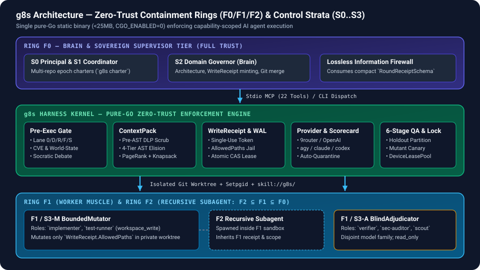
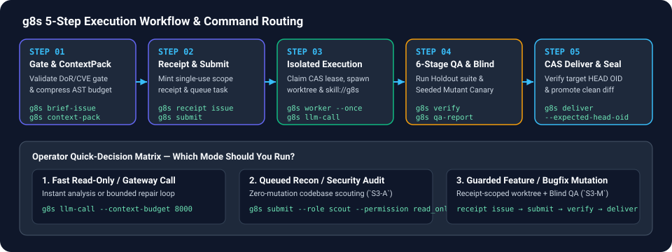

<p align="center">
  
</p>

# g8s (The Gatekeepers)

> **A Verifiable Zero-Trust Execution & Evolution Infrastructure for Autonomous AI Agents (<20MB stripped pure-Go release binary per arch) — combining OS sandboxing (Seatbelt / `bwrap`+Landlock / `JobObject`), Ed25519 capability receipts, and Git worktree firewalls.**  
> *"k8s orchestrates your compute containers; g8s orchestrates your AI subagents."*

<p align="center">
  🌐 <a href="https://g8s.flowaxon.com"><b>g8s.flowaxon.com</b></a> — landing page, 36s product reel, and <a href="https://g8s.flowaxon.com/gate-room.html">The Gate Room</a>: an interactive 3D containment hall where the laws are the physics.
</p>

[](LICENSE)
[](https://golang.org)
[](https://github.com/tamld/g8s)
[](https://github.com/tamld/g8s/releases)

<p align="center">
  <b>English</b> | <a href="README.vi.md">Tiếng Việt</a>
</p>

---

## 1. Why g8s?

Giving autonomous AI agents (Claude, GPT, Codex, Gemini) ambient shell access invites silent working-tree corruption, out-of-scope edits, secret leakage, and runaway loops.

`g8s` does not assume an AI model is always right; it enforces that even when an agent errs, is prompt-injected, or self-modifies, safety boundaries, independent verification, and atomic recovery hold outside LLM inference ([ADR-0042](docs/decisions/0042-verifiable-zero-trust-evolution-infrastructure.md)). Distributed as a single static pure-Go binary with zero CGO dependencies, `g8s` isolates every worker attempt into a private Git worktree, enforces single-use path-scoped Ed25519 receipts, and seals auditable evidence.

| Dimension | Without g8s (Ambient Shell) | With g8s (Zero-Trust Harness) |
| :--- | :--- | :--- |
| **Execution Authority** | Ambient machine access; agent can mutate anything. | Role-scoped profiles (`read_only`, `automation_read`, `workspace_write`, `supplied_text`). |
| **Filesystem Safety** | Unchecked edits corrupt the main checkout. | Single-use Ed25519 `WriteReceipt` (`rc1:`), OS write jail on Unix, and NUL `-z` Git worktree diff firewall (`VerifyWorktreeDiffScope`). |
| **Process & Network Isolation** | Orphan zombies survive crashes; API keys leak via env. | `ScrubEnv` allowlists, OS process-tree reaping (`Setpgid`, `JobObject`), and explicit `network_enforcement` reporting. |
| **Task Durability & Context** | Ephemeral agent memory; logs flood coordinator context. | SQLite WAL queue with CAS leases + lossless `RoundReceiptSchema` firewall. |
| **Gateway & Self-Improvement** | Ad-hoc scripts or unguarded self-edits to security rules. | Vendor-neutral `g8s llm-call` + immutable `S0` Trust Root (`TRUST-G1..G6`) + `PASS`/`FAIL` memory promotion gate. |

- **Brain (`F0`)** ([ADR-0032](docs/decisions/0032-containment-levels.md), [ADR-0035](docs/decisions/0035-orthogonal-stratum-federation.md)): Reasoning coordinator owning decomposition, review, and CAS commit delivery — see [`AGENTS.md`](AGENTS.md) for the machine-facing protocol.
- **Worker (`F1`)**: Bounded external CLI (`agy`, `claude`, `codex`, `cursor`, `gemini`, `opencode`, `qwen`, `ollama`, …) or HTTP endpoint (`openai`, `anthropic`, or Layer 2 local gateway) executing one isolated attempt.
- **Subagent (`F2`)**: Recursive helper spawned by F1 inside F1's existing worktree and receipt boundary (`F2 ⊆ F1 ⊆ F0`).

---

## 2. How It Works

`g8s` separates physical containment (`F0 / F1 / F2`) from control authority (`S0..S3 + O-Plane`):

<p align="center">
  
</p>

1. **Submit & Gate**: Coordinator issues a path-scoped single-use `WriteReceipt` (`g8s receipt issue`), validates the lane (`g8s brief-issue`), and queues work in SQLite WAL (`g8s submit`).
2. **Lease**: Worker claims a task via atomic Compare-And-Swap (`g8s worker --once`).
3. **Contain & Hydrate**: Harness spawns the worker inside a private Git worktree, OS sandbox/process group, scrubbed env, and digest-pinned skills.
4. **Verify**: Out-of-worktree holdout suites, mutant canary checks, and diff firewalls run (`g8s verify`), emitting a compact `RoundReceiptSchema`.
5. **Seal & CAS Deliver**: Verified diffs promote only when the target OID matches (`g8s deliver --expected-head-oid <sha>`), with TCB changes gated by `S0` human Ed25519 approval.

<details>
<summary>5-Step Command Routing Diagram</summary>

<p align="center">
  
</p>

</details>

---

## 3. 30-Second Quickstart

```bash
# 1. Read-only scout task
g8s submit --profile scout-fast --idempotency-key "scout-01" \
  --prompt "Scan internal/provider and map exported interfaces"
g8s worker --once

# 2. Capability-scoped write task (single-use path-scoped receipt)
RECEIPT_ID=$(g8s receipt issue --path "internal/config/*.go" --json | g8s select data.receipt_id)
g8s submit --idempotency-key "cfg-test-01" --role test-runner \
  --permission workspace_write --allow-workspace-write --receipt-id "$RECEIPT_ID" \
  --prompt "Add unit tests for config validation in internal/config"
g8s worker --once --allow-workspace-write

# 3. Direct config-driven LLM call (OpenAI/Anthropic-compatible HTTP)
g8s llm-call --provider openai --model gpt-5.5 --effort high \
  --prompt "Review internal/fsops for race conditions"
```

See [Quickstart Guide](docs/quickstart.md) for end-to-end onboarding and [Native Agent I/O Guide](offer/SEARCH_GUIDE.md) for pure-Go `g8s search`, `g8s read`, `g8s edit`, and `g8s select`.

---

## 4. Installation

**macOS / Linux:**
```bash
curl -fsSL https://raw.githubusercontent.com/tamld/g8s/main/scripts/install.sh | bash
```

**Windows (PowerShell):**
```powershell
irm https://raw.githubusercontent.com/tamld/g8s/main/scripts/install.ps1 | iex
```

Both installers **fail closed** on SHA-256 verification against the release `checksums.txt`; pass `--verify-signature` (or `G8S_VERIFY_SIGNATURE=1`) to `scripts/install.sh` to enforce Cosign Sigstore or GitHub attestation verification ([Releases](https://github.com/tamld/g8s/releases)).

| Platform | Architectures | Release Asset Pattern |
| :--- | :--- | :--- |
| **macOS** (universal) | `darwin/amd64`, `darwin/arm64` | `g8s_<version>_darwin_all.tar.gz` |
| **Linux** | `linux/amd64`, `linux/arm64` | `g8s_<version>_linux_{amd64,arm64}.tar.gz` (plus `.deb`, `.rpm`, `.apk`) |
| **Windows** | `windows/amd64`, `windows/arm64` | `g8s_<version>_windows_{amd64,arm64}.zip` |

<details>
<summary>Package managers (Homebrew, Scoop, Linux .deb/.rpm/.apk), Go 1.26.11+, Build from source & Verification</summary>

**Homebrew (macOS / Linux):**
```bash
brew install tamld/g8s/g8s
```

**Scoop (Windows):**
```powershell
scoop bucket add tamld https://github.com/tamld/scoop-bucket
scoop install tamld/g8s
```

**Linux packages (download from [GitHub Releases](https://github.com/tamld/g8s/releases)):**
```bash
sudo dpkg -i g8s_*_linux_amd64.deb                      # Debian/Ubuntu
sudo rpm -i g8s_*_linux_amd64.rpm                         # RHEL/Fedora
sudo apk add --allow-untrusted ./g8s_*_linux_amd64.apk    # Alpine
```

**Via Go Toolchain (`go1.26.11`+) or From Source:**
```bash
go install github.com/tamld/g8s/cmd/g8s@latest

# Or clone & build local binary with commit provenance:
git clone https://github.com/tamld/g8s.git && cd g8s && make local && ./bin/g8s doctor --json
```

**Verify downloads & lifecycle commands:**
1. **SHA-256**: `sha256sum -c checksums.txt` (`Get-FileHash` on Windows; automatic in one-line installers).
2. **Attestation / Sigstore**: `gh attestation verify <asset> -R tamld/g8s --owner tamld` or `cosign verify-blob --bundle checksums.txt.sigstore.json checksums.txt`.
3. **Lifecycle**: `g8s init`, `g8s doctor`, `g8s update`, `g8s uninstall`, `g8s service install|start|status`, `g8s version`. See [Windows Installation](docs/WINDOWS_INSTALL.md) and [Release Rollback](docs/release/ROLLBACK.md).

</details>

---

## 5. Containment & TRUST Assurance Status

`g8s` reports security posture honestly per host OS and per binary (`ENFORCED`, `MEDIATED_ONLY`, `NOT_ENFORCED`, `UNVERIFIED`) under the [ADR-0042](docs/decisions/0042-verifiable-zero-trust-evolution-infrastructure.md) non-compensatory rule — aggregate probe scores never mask an unverified or degraded gate (`TRUST-G1..G6`):

| Platform | OS Containment & `TRUST-G1` Posture | Control-Plane Backstops & Caveats |
| :--- | :--- | :--- |
| **macOS (`darwin`)** | `ENFORCED` via XNU Seatbelt (`kernel_enforced`), `(deny network-outbound)`, `ScrubEnv`, `-pgid` + `G8S_SANDBOX_ID` sweep | Ed25519 receipts, WAL CAS, NUL `-z` diff firewall; external `SIGKILL` swept by `g8s cleanup` |
| **Linux (`linux`)** | `ENFORCED` via `bwrap --unshare-net`; `MEDIATED_ONLY` via Landlock LSM (no OS socket block); `NOT_ENFORCED` if `policy_only` | Ed25519 receipts, WAL CAS, diff firewall; fail closed with `--require-kernel-sandbox` |
| **Windows (`windows`)** | `MEDIATED_ONLY` via Win32 `JobObject` (`KILL_ON_JOB_CLOSE`, `job_object_env_scrubbed`) + `ScrubEnv` | No kernel FS ACLs or OS socket block yet; relies on Ed25519 scope + diff firewall |

Reproduce live non-compensatory telemetry and all 5 offline assurance probes (`as-001`..`as-005`) with zero API keys:

```bash
g8s doctor --json                    # per-OS binary provenance + trust_assurance_status
bash tools/assurance_benchmark.sh    # offline escape, mutant-canary, RTO, CAS, and audit suite
```

Quantitative claims in [`docs/claims.yml`](docs/claims.yml) are bound via `tools/claims_check.sh`. For the full threat matrix, SAST/DAST/IAST/Fuzzing controls, and distinction between tagged `v0.25.0` and `main` hardening, see [Containment & Threat-Model Matrix](docs/security/containment-matrix.md) and [OWASP Agentic, SLSA & SBOM Security](docs/security/owasp-agentic-slsa-sbom.md).

---

## 6. MCP Server, Skills & Documentation

`g8s mcp` exposes a native stdio JSON-RPC Model Context Protocol server for Claude Desktop, Cursor, Windsurf, and Antigravity.

<details>
<summary>All 23 Registered MCP Tools (22 active + g8s_run stub — click to expand)</summary>

| Category | Tools | Reference |
| :--- | :--- | :--- |
| **Tasks & Containment** | `g8s_submit`, `g8s_dispatch`, `g8s_get`, `g8s_list_tasks`, `g8s_cancel_task`, `g8s_receipt_issue`, `g8s_run` | [MCP Tools Reference](docs/user-guide/mcp-tools.md) |
| **Agent I/O & Context** | `g8s_search`, `g8s_read`, `g8s_edit`, `g8s_select`, `g8s_blast_radius`, `g8s_context_pack` | [MCP Tools Reference](docs/user-guide/mcp-tools.md) |
| **LLM & Introspection** | `g8s_llm_call`, `g8s_self_awareness`, `g8s_list_roles`, `g8s_list_permissions` | [MCP Tools Reference](docs/user-guide/mcp-tools.md) |
| **Federation, Skills & Mesh** | `g8s_charter_issue`, `g8s_charter_verify`, `g8s_portfolio_status`, `g8s_skills_list`, `g8s_skills_read`, `g8s_coordinator_mesh` | [MCP Tools Reference](docs/user-guide/mcp-tools.md) |

</details>

> [!NOTE]
> **AI Agents & Sibling Repos**: Autonomous coordinators should read [`AGENTS.md`](AGENTS.md), [`manifest.json`](manifest.json), and [`skills/g8s-supervisor/SKILL.md`](skills/g8s-supervisor/SKILL.md). External repos can adopt `g8s` via the pull-based [`offer/` Bundle](offer/README.md).

### Documentation Index

| Document | Focus |
| :--- | :--- |
| [Quickstart Guide](docs/quickstart.md) | First install to receipt-scoped delegation |
| [CLI Reference](docs/user-guide/cli-reference.md) & [MCP Reference](docs/user-guide/mcp-tools.md) | Subcommands, flags, exit codes, and 23 JSON-RPC schemas |
| [Native Agent I/O Guide](offer/SEARCH_GUIDE.md) | Pure-Go `search`, `read`, `edit`, and `select` |
| [Containment & Threat-Model Matrix](docs/security/containment-matrix.md) | 3-OS kernel vs. Ed25519 vs. diff-firewall guarantees |
| [OWASP Agentic, SLSA & SBOM](docs/security/owasp-agentic-slsa-sbom.md) | Security controls, Cosign verification, SPDX SBOMs |
| [ADR-0042: TRUST North Star](docs/decisions/0042-verifiable-zero-trust-evolution-infrastructure.md) & [All ADRs](docs/decisions/) | Trust Root outside LLM inference and `TRUST-G1..G6` |
| [PRD](docs/PRD.md), [SRS](docs/SRS.md) & [DoD/DoR](docs/DOD_DOR.md) | Requirements and engineering acceptance standards |
| [Windows Install](docs/WINDOWS_INSTALL.md) & [Rollback](docs/release/ROLLBACK.md) | Windows troubleshooting and binary rollback steps |
| [Architecture Roadmap](docs/ARCHITECTURE_ROADMAP.md) & [Changelog](CHANGELOG.md) | Release history (`v0.18.0`–`v0.25.0`) and milestone plan |

### Roadmap Snapshot & Non-Goals

| Milestone | Scope | Status |
| :--- | :--- | :---: |
| **`v0.25.0`** (2026-11-18) | Kernel 3-OS sandboxing, Ed25519 receipts/charters, `faultworker` E2E, `as-001`..`as-005` benchmark | **Released** |
| **`main`** (post-`v0.25.0`) | Hardened `-z` firewall, `--require-kernel-sandbox`, S0 human TCB keys, `TRUST-G1..G6` enforcement & status telemetry | **In Progress** |
| **`v0.30.0`** | In-worktree Scoped MCP/Network Capability Proxy, `Tier A` canary self-improvement, 90-day Offer burn-in | **Planned** |
| **`v1.0.0`** | Full `TRUST-G1..G6` pass, $\ge 50$ receipt-backed real dispatches, $\ge 90\%$ First-Pass Yield | **Planned** |

**Explicit Non-Goals**: `g8s` is a single-host CLI/SQLite WAL orchestrator (`S1 -> S2` charter federation only); distributed Raft consensus, dynamic C/Go plugins, in-process LLM weight hosting, and heavy web UIs are out of scope.

<details>
<summary>Project Structure (auto-synced Go package map)</summary>

<!-- structure:start -->
```
g8s/
├── cmd/g8s/                # CLI entrypoint (stdlib flag-based, no cobra)
├── internal/               # All packages (private, not importable)
│   ├── analyzer/ — implements AST-based reference tracking and Blast Radius Intelligence per OpenSpec DELTA-07, quantifying code change impact and generating optimal write receipt path scopes
│   ├── autopilot/ — implements the cron-based supervisor trigger that scans GitHub issues, failing CI runs, static analysis findings, and stale @agy-fix-me TODOs
│   ├── brief/ — implements structured brief dispatch and consumption contracts backed by the control plane SQLite store
│   ├── charter/ — implements the Orthogonal Stratum Federation (S0..S3 + O-Plane) and Epoch-Fenced Charter Engine (DELTA-33 / ADR-0035)
│   ├── cleanup/ — implements ghost process and orphan resource detection and purging for g8s lifecycle management per DEBT-28 and DEBT-32
│   ├── cli/ — defines the unified JSON envelope and standard flag parsing conventions for the g8s command-line interface per DEBT-30
│   ├── codeintel/ — implements multi-tier code intelligence and blast radius analysis per OpenSpec DELTA-20, adhering to the "Fat Kernel + Thin Adapters" architecture pattern
│   ├── completion/ — generates shell auto-completion scripts for bash, zsh, and fish
│   ├── config/ — loads the operator-declared provider registry that feeds the two-class resource pool (DELTA-10): api_call proxy pools defined by hand and platform_dispatch entries resolved from local CLI binaries
│   ├── context/ — is the Context Broker (ADR-0021 §8.2, #396): it assembles a bounded situational ContextPacket per deployment point from the knowledge vault (post promotion gate, #395), the telemetry ledger (recent outcomes, failure signatures), and the SOM state (current phase, DoR status)
│   ├── contextpack/ — implements pure-Go AST and lexical 4-tier context compression (FULL, SKEL, SIGS, TREE), Personalized PageRank + BM25F scoring, and a Multiple-Choice Knapsack token budget optimizer (DELTA-36)
│   ├── controlplane/ — implements the DELTA-03 SQLite-backed task queue with compare-and-swap leases and an append-only event log, ported from the Python baseline (reference/python/scripts/agy_control_plane.py) under the g8s Zero-CGO constitution: modernc.org/sqlite only, injectable deterministic clock, and per-operation connection pragmas
│   ├── conv/ — executes multi-worker dual-blind design runs and synthesizes proposals into converged specifications
│   ├── dialectic/ — implements the Dialectic Bounce lifecycle (#258 Phase A): a deterministic debate engine where a thesis is refined through bounded critique rounds
│   ├── diffintel/ — implements pure-Go unified diff parsing, noise pruning, and context slicing for high-precision, token-efficient subagent code reviews
│   ├── dispatch/ — implements the bounded AGY CLI dispatch adapter — the original worker bridge, ported from reference/python/scripts/agy_dispatch.py
│   ├── doctor/ — implements diagnostic sanity checks for g8s environment, security boundaries, permissions, and worker binary availability
│   ├── dogfood/ — classifies commit provenance without performing Git I/O
│   ├── featuremap/ — provides declarative end-to-end feature DAG loading, validation, and blast-radius routing
│   ├── fsops/ — implements safe, receipt-bounded file system operations including bounded reads, DLP sanitization, atomic edits, and delegation context resolution
│   ├── harness/ — enforces worker execution boundaries, permission profiles, role constraints, and prompt safety scanning
│   ├── heartbeat/ — implements per-session worker heartbeat tracking and freshness observability per DEBT-29
│   ├── hooks/ — provides lifecycle hook implementations for g8s orchestrator workers
│   ├── initwiz/ — provides interactive and headless onboarding wizards for g8s, auto-detecting installed AI IDEs and generating MCP configuration blocks
│   ├── ladder/ — implements the quality-ladder failure classification, policy escalation, and telemetry gauges
│   ├── lane/ — implements ALDC Layer 1 gate-lane routing and Layer 2 Jev-assisted ambiguity resolution (issue #514, ADR-0024 S6-3, SCORECARD S-6)
│   ├── lessons/ — implements schema, append-only ledger, and fail-closed machine checks for retrospective lessons
│   ├── lifecycle/ — implements the DELTA-40 binary lifecycle surface: self-update from GitHub releases with fail-closed SHA-256 verification and atomic binary replacement, plus a dry-run-first uninstall planner
│   ├── lockfile/ — provides non-blocking exclusive advisory file locks used to arbitrate concurrent supervisor sessions over one checkout (#393)
│   ├── mcp/ — implements the g8s Model Context Protocol (MCP) server over stdio using newline-delimited JSON-RPC 2.0 (DELTA-04)
│   ├── memory/ — provides a unified memory facade across working, episodic, semantic, and capability storage tiers
│   ├── mesh/ — implements peer-to-peer coordinator claim fencing, keepalive leases, and message transport across federated g8s nodes (DELTA-46)
│   ├── orchestrator/ — implements the Brain→Worker fan-out layer that sits on top of internal/dispatch (the AGY CLI adapter, one backend among many) and internal/controlplane (SQLite WAL task store)
│   ├── pathutil/ — provides cross-platform path resolution for g8s data, configuration, cache, and state files across Windows, Linux, and macOS
│   ├── premise/ — implements the DELTA-42 Premise Challenge & Sycophancy Gate: it decomposes an operator request or supervisor brief into atomic claims and classifies each claim into an evidence tier
│   ├── process/ — provides cross-platform process discovery, inspection, and termination primitives for g8s lifecycle management per DEBT-36
│   ├── provider/ — implements native discovery and concurrency governance for external AI worker binaries, per DELTA-05 (spec/openspec/05-provider-and-resource-pool-spec.md)
│   ├── reach/ — implements read-only platform data acquisition: an in-code channel registry, ordered fallback dispatch, and error classification for external research fetches
│   ├── receipt/ — implements zero-trust write receipts for delegated workspace mutations
│   ├── reflection/ — defines the evidence-bound D-09 JUDGE contract
│   ├── reflex/ — implements a System 1 non-autoregressive decision gate for g8s subagent mutation triage, write receipt fast-pathing, and instant circuit-breaking on sandbox escapes
│   ├── registry/ — provides a cross-platform wrapper around Windows registry operations for installer detection, path validation, and system environment checks
│   ├── review/ — parses, validates, and aggregates code review findings from verifier workers into structured summaries
│   ├── routing/ — CI workflow run history for reflex scorecard (D9-S1, #714)
│   ├── runtime/ — provides runtime verification utilities for executable identity and process management
│   ├── sandbox/ — enforces OS-level subprocess containment and environment secret scrubbing for worker execution
│   ├── search/ — implements a native cross-platform file discovery and content search engine
│   ├── server/ — implements the g8s daemon mode with HTTP API server
│   ├── service/ — manages the g8s background worker as an OS daemon
│   ├── settings/ — manages persistent, atomic user and system configurations for g8s
│   ├── signing/ — provides code signing and signature verification primitives for g8s binaries and installation packages across supported operating systems
│   ├── sleep/ — manages operator away cycles, tracks background execution events, and generates wake-up briefings
│   ├── state/ — implements pure FSM transition validation and append-only event logging across all g8s lifecycle domains per DEBT-31
│   ├── supervisor/ — coordinates the fix loop across planning, role enforcement, worker execution, review, and RCA
│   ├── telemetry/ — ingests execution trace events, distills failure patterns, and provides preflight context injection
│   ├── testenv/ — provides helpers imported only by test files
│   ├── vault/ — implements a Zero-CGO, decoupled Knowledge Vault for g8s utilizing SQLite FTS5 with BM25 ranking to index and retrieve Tri-Anchor contextual distillation records
│   ├── verifier/ — implements verifier-class registry and acceptance verification (issue #515, SCORECARD S-7)
│   ├── watch/ — implements the blocking watch primitive (#371): poll a condition until it reaches a terminal state, then emit a verdict
│   ├── worker/ — provides worker lifecycle supervision, execution containment, and background heartbeat emission shims per DELTA-29
│   └── ...                 # supporting packages
├── offer.go                # root package: go:embed glue for the offer/ bundle + spec-sync gate scripts
├── assets/                 # Logo and release artwork
├── offer/                  # Pull-bundle for sibling projects (profiles, onboarding, seeds)
├── docs/                   # User guide, ADRs, specs, security, history
├── examples/               # Contributor brief template
├── packaging/              # Windows NSIS/WiX, Chocolatey, winget
├── plans/                  # Campaign ledgers (dated, session-type marked)
├── reference/              # JIT-only Python baseline (read, never import)
├── schemas/                # JSON schemas (task, receipt, result)
├── scripts/                # Public installer (scripts/install.sh curl entrypoint)
├── skills/                 # Vendored agent skills (g8s-supervisor charter + manifest)
├── spec/openspec/          # OpenSpec deltas (DELTA-01..49)
├── tools/                  # CI helper scripts (pre-push gates, SAST, release)
├── .g8s/                   # Declarative governance registries (models, effort, lanes, trust)
├── .semgrep/               # Offline AST security & explicit-error rules (g8s-rules.yml)
└── .github/workflows/      # CI/CD pipelines (ci, quality, codeql, govulncheck, fuzz, release)
```
<!-- structure:end -->

</details>

---

## 7. License

Distributed under the **MIT License**. Copyright (c) 2026 TamLD. See [LICENSE](LICENSE) for details.

**Independent OSS & Vendor ToS Compliance**: `g8s` is an independent open-source project not affiliated with or endorsed by Google, Anthropic, OpenAI, Cursor, or any model vendor. Operators supply their own official CLIs and API keys in accordance with vendor Terms of Service.
