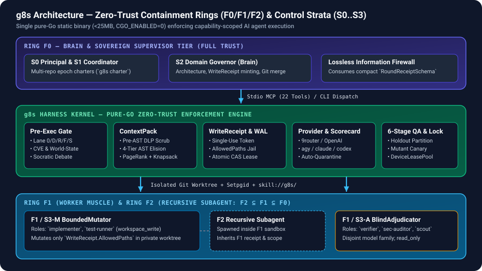
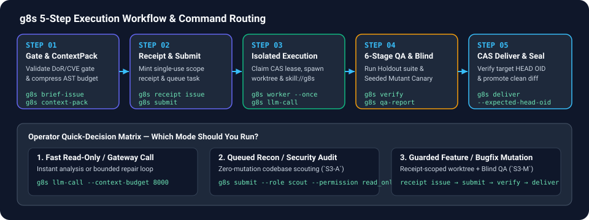

<p align="center">
  
</p>

# g8s (The Gatekeepers)

> **Single-binary zero-trust process execution harness (<25MB static pure-Go binary) for AI agent CLI workers.**  
> *"k8s orchestrates your compute containers; g8s orchestrates your AI subagents."*

[](LICENSE)
[](https://golang.org)
[](https://github.com/tamld/g8s)
[](https://github.com/tamld/g8s/releases)

<p align="center">
  <b>English</b> | <a href="README.vi.md">Tiếng Việt</a>
</p>

---

## 1. Overview & Why g8s?

When autonomous AI coding agents (Claude, GPT, Codex, Gemini) execute tasks on local machines, giving them ambient shell authority invites catastrophe: accidental deletions, out-of-scope edits, dropped files, runaway loops, and environment leakage.

`g8s` solves this by introducing a **symmetric zero-trust boundary** between the reasoning model ("Brain") and mechanical execution workers ("Muscle"). Built as a single static pure-Go binary with zero CGO dependencies, `g8s` isolates execution into private Git worktrees, enforces path-scoped write receipts, and captures durable evidence.

### Without g8s vs. With g8s

| Dimension | Without g8s (Ambient Shell) | With g8s (Zero-Trust Harness) |
| :--- | :--- | :--- |
| **Execution Authority** | Ambient user machine access; worker can touch anything. | Strict role-based permission profiles (`read_only`, `workspace_write`). |
| **Filesystem Safety** | Unchecked file mutations directly corrupt working tree. | Path-scoped, single-use `WriteReceipt`s enforced in-process (`AllowedPaths`). |
| **Process Containment** | Child processes survive crashes as orphan zombies. | Isolated OS process groups (`Setpgid`) terminating cleanly on cancel/timeout. |
| **Task Durability** | Stored in ephemeral agent memory; lost on disconnect. | SQLite WAL task queue with atomic Compare-And-Swap (CAS) leases. |
| **LLM Gateway Access** | Ad-hoc Python scripts or proprietary closed agent clouds. | Universal config-driven consumer (`g8s llm-call`, `9router`, OpenAI, Anthropic). |
| **Supervisor Context** | Flooded with megabytes of noisy test/CI raw logs. | Lossless Information Firewall (`RoundReceiptSchema` strips noise, preserves failures). |

### Core Terminology

| Term | Architectural Definition |
| :--- | :--- |
| **Brain (`F0`)** | High-tier orchestrator (Claude 3.7 Sonnet / Opus, GPT-4o, Codex) holding strategic reasoning and commit authority. |
| **Worker (`F1`)** | Bounded CLI worker process (`agy`, `claude`, `gemini`, `ollama`) or HTTP gateway consumer executing one scoped packet. |
| **Subagent (`F2`)** | Ephemeral subagent spawned recursively by F1 within F1's existing worktree and receipt boundary (`F2 ⊆ F1 ⊆ F0`). |
| **Task** | An atomic, durable work item queued in the SQLite WAL store with an idempotency key and attempt budget. |
| **Receipt** | A cryptographically validated single-use authorization token granting scoped filesystem write permissions (`AllowedPaths`). |
| **Attempt** | A concrete execution attempt of a task, isolated in a private Git worktree and process group. |
| **Evidence Lake** | An append-only durable store capturing execution receipts, telemetry events, and physical diffs on disk. |

---

## 2. Architecture & Execution Lifecycle

`g8s` structures multi-agent collaboration across a 2-Axis Orthogonal Architecture (**Axis X**: `F0 / F1 / F2` Containment Rings per [ADR-0032](docs/decisions/0032-containment-levels.md) $\times$ **Axis Y**: `S0..S3 + O-Plane` Control Strata per [ADR-0035](docs/decisions/0035-orthogonal-stratum-federation.md)):

<p align="center">
  
</p>

### 5-Step Execution Lifecycle & Visual Workflow

1. **Submit & Gate**: Operator / Brain (`F0`) validates the task brief (`g8s brief-issue --lane <0|D|R|F|S>`), optionally compresses codebase context (`g8s context-pack`), issues a single-use path-scoped `WriteReceipt` (`g8s receipt issue`), and queues the task (`g8s submit`).
2. **Lease**: Worker (`F1`) acquires the queued task via an atomic Compare-And-Swap (CAS) lease in SQLite WAL (`g8s worker --once`).
3. **Contain & Hydrate**: Harness spawns the worker inside an isolated Git worktree and killable OS process group (`Setpgid`), hydrating digest-pinned skills (`skill://g8s/<tier>/<name>`) and bounded context.
4. **Verify (6-Stage QA & Blind Audit)**: Verification gate (`g8s verify` & `g8s qa-report`) executes tests inside the worktree, runs out-of-worktree holdout suites + seeded mutant canary checks, and emits a compact `RoundReceiptSchema` across the Information Firewall.
5. **Seal & CAS Deliver**: Outcome is sealed in a durable receipt; Brain inspects the physical diff and promotes changes via optimistic concurrency check (`g8s deliver --expected-head-oid <sha>`).

<p align="center">
  
</p>

---

## 3. Core Capabilities

| Domain | Architectural Capability | Primary Surface |
| :--- | :--- | :--- |
| **Zero-Trust Containment** | Single-use path-scoped `WriteReceipt`s, POSIX process groups, and isolated Git worktrees. | `g8s receipt issue`, `g8s worker` |
| **Durable Task Queue** | SQLite WAL storage, atomic CAS leases, idempotency deduplication, and retry policies. | `g8s submit`, `g8s watch`, `g8s status` |
| **Native Agent I/O & ContextPack** | Pure-Go file discovery (`search`), bounded reader (`read`), atomic editor (`edit`), JSON selector (`select`), and 4-tier AST + PageRank + Knapsack context compressor (`context-pack`). | `g8s search`, `g8s read`, `g8s edit`, `g8s select`, `g8s context-pack` |
| **Universal LLM Consumer** | Config-driven direct synchronous CLI (`llm-call`) and worker queue execution for OpenAI/Anthropic/9Router with continuous model scorecard & dynamic quarantine. | `g8s llm-call`, `g8s providers discover`, `g8s providers scorecard` |
| **6-Stage AI QA & Blind Verify** | BA-to-Spec contract validation, holdout partition isolation, seeded mutant canary, and epistemic audit (`MECHANICAL_VERIFIED` vs `UNVERIFIED_PROSE`). | `g8s verify`, `g8s qa-report` |
| **Decoupled Knowledge Vault** | Sub-millisecond SQLite FTS5 + BM25 ranked indexing of architectural records and JIT spatial whispers. | `g8s vault store`, `g8s vault query` |

---

## 4. Installation

`g8s` is distributed as a single static, self-contained binary (<25MB) with zero external runtime dependencies.

### Pre-built Binaries (GitHub Releases)

Download pre-compiled binaries for your architecture from [GitHub Releases](https://github.com/tamld/g8s/releases):
- macOS (Apple Silicon `arm64` / Intel `amd64`)
- Linux (`amd64` / `arm64`)
- Windows (`amd64`)

### Via Go Toolchain (`go1.26.10`+)

```bash
go install github.com/tamld/g8s/cmd/g8s@latest
```

### Build from Source

```bash
git clone https://github.com/tamld/g8s.git
cd g8s
make local
./bin/g8s doctor --json
```

---

## 5. Usage Paradigms (Quickstart)

### Paradigm 1: Read-Only Reconnaissance
Safely explore a codebase without granting write permissions:
```bash
# Submit a read-only reconnaissance task
g8s submit \
  --idempotency-key "scout-providers-01" \
  --role scout \
  --permission read_only \
  --prompt "Scan internal/provider and map all exported interfaces"

# Run one worker attempt to process the task
g8s worker --once
```

### Paradigm 2: Capability-Scoped Mutation
Issue a single-use, path-scoped receipt before mutating files:
```bash
# 1. Issue single-use write receipt scoped to a specific directory
RECEIPT_ID=$(g8s receipt issue --path "internal/config/*.go" --json | g8s select --selector .data.receipt_id)

# 2. Dispatch worker bounded by the receipt
export AGY_MCP_ALLOW_WORKSPACE_WRITE=1
g8s submit \
  --idempotency-key "test-config-01" \
  --role test-runner \
  --permission workspace_write \
  --receipt-id "$RECEIPT_ID" \
  --prompt "Add unit tests for config validation in internal/config"

g8s worker --once
```

### Paradigm 3: Universal Config-Driven LLM Gateway Consumer
Directly invoke or queue tasks across configured remote LLM gateways (OpenAI, Anthropic, 9Router):
```bash
# Direct synchronous execution with reasoning effort and file block application
g8s llm-call \
  --provider 9router \
  --model reasoning-high \
  --effort high \
  --prompt "Review internal/fsops for race conditions"

# Live model discovery
g8s providers discover --provider 9router --json
```

### Paradigm 4: Native Cross-Platform Agent I/O
Pure-Go high-performance replacements for external CLI utilities:
```bash
# Search codebase (replaces rg / grep / find)
g8s search "WriteReceipt" --globs "*.go"

# Bounded read with SHA-256 fingerprint (replaces sed -n / cat / head)
g8s read internal/provider/registry.go --lines 20:50

# Atomic compare-and-swap edit (replaces sed -i / awk)
g8s edit internal/config/config.go --old "timeout = 30s" --new "timeout = 60s"

# Extract JSON dot-path value (replaces jq)
cat result.json | g8s select --selector .data.status
```

---

## 6. MCP, Agent Skills & Offer Bundle

### Model Context Protocol (MCP) Server

`g8s` runs as a native stdio Model Context Protocol (MCP) server supporting IDE hosts (Claude Desktop, Cursor, Windsurf, Antigravity):

```bash
g8s mcp
```

#### Complete MCP Tool Inventory (22 Tools)

| Tool Name | Operation & Purpose |
| :--- | :--- |
| `g8s_run` | Synchronously execute an isolated worker task (requires Phase 4 supervisor). |
| `g8s_submit` | Enqueue a durable task with role, permissions, and timeout budget. |
| `g8s_get` | Fetch sanitized task status by task ID. |
| `g8s_receipt_issue` | Issue a single-use, path-scoped, time-limited Write Receipt. |
| `g8s_self_awareness` | Report discovered providers, model availability, and concurrency slots. |
| `g8s_blast_radius` | LSP and AST call-hierarchy impact analysis for a file/symbol (`DELTA-07`). |
| `g8s_dispatch` | Execute a bounded, read-only dispatch through the CLI wrapper. |
| `g8s_list_tasks` | List tasks filtered by state (`QUEUED`, `LEASED`, `SUCCEEDED`, `FAILED`). |
| `g8s_cancel_task` | Request cooperative cancellation of a durable task with an audit reason. |
| `g8s_list_roles` | Enumerate all 10 registered worker role profiles and default permissions. |
| `g8s_list_permissions` | Enumerate permission profiles (`read_only`, `automation_read`, `workspace_write`, `supplied_text`). |
| `g8s_search` | Pure-Go regex and literal file search with gitignore awareness (`DELTA-22/23`). |
| `g8s_read` | Bounded file reading with line-range slicing and SHA-256 validation (`DELTA-23`). |
| `g8s_edit` | Atomic CAS file editing with CRLF/LF preservation and receipt checks (`DELTA-23`). |
| `g8s_select` | Pure-Go JSON dot-path selector (replaces jq; `DELTA-23`). |
| `g8s_llm_call` | Direct synchronous LLM invocation across configured providers (`DELTA-25`). |
| `g8s_charter_issue` | Issue an epoch-fenced Stratum Charter (`S0/S1 -> S2`) (`DELTA-33`). |
| `g8s_charter_verify` | Verify a Stratum Charter epoch and fence token (`DELTA-33`). |
| `g8s_portfolio_status` | O-Plane read-only projection of active/revoked/completed Stratum Charters (`DELTA-33`). |
| `g8s_skills_list` | List digest-pinned skills (`skill://g8s/<tier>/<name>`) filtered by F0/F1/F2 tier (`DELTA-34`). |
| `g8s_skills_read` | Read a verified `SKILL.md` with optional `expected_digest` SHA-256 TOCTOU check (`DELTA-34`). |
| `g8s_context_pack` | Pure-Go 4-tier AST elision, PageRank + BM25F, and Knapsack context compressor (`DELTA-36`). |
| `g8s_coordinator_mesh` | Execute explicit-directory peer coordinator SQLite WAL ledger operations (`DELTA-46`). |

### Agent Skills & Supervisor Charter

The canonical operating charter for `g8s` supervisors is vendored at [`skills/g8s-supervisor/SKILL.md`](skills/g8s-supervisor/SKILL.md) (`v4.3.0`), registered in [`skills/manifest.json`](skills/manifest.json), and governed by [`skills/g8s-supervisor/references/doc-standard.md`](skills/g8s-supervisor/references/doc-standard.md).

### Sibling Repo Adoption via Offer Bundle

Other repositories adopt `g8s` via the pull-based Offer Bundle ([`offer/README.md`](offer/README.md)), providing 4 domain profiles ([`knowledge`](offer/profiles/knowledge.md), [`security`](offer/profiles/security.md), [`infra`](offer/profiles/infra.md), [`utility`](offer/profiles/utility.md)) and 3 CI sync gates.

> [!NOTE]
> **AI Agent SSoT Discovery**: Autonomous agents entering this repository should inspect [`manifest.json`](manifest.json) for machine-readable schemas and [`AGENTS.md`](AGENTS.md) for the complete 5-step reading order.

---

## 7. Scope & Non-Goals

To maintain high reliability and performance, `g8s` explicitly bounds its product scope:

| Target Domain | Architectural Decision & Non-Goal |
| :--- | :--- |
| **In-Process Plugins** | **Non-Goal**: Dynamic in-process C/Go plugins. `g8s` uses **Declarative Config + Standard Protocols** (`providers.json`, JSON-RPC MCP, CLI subprocesses) to prevent runtime compilation fragility and sandbox escapes. |
| **Heavy Frameworks** | **Non-Goal**: Heavy Python runtimes (LangChain, AutoGen). `g8s` is a pure-Go, zero-dependency static binary. |
| **GUI Dashboard Bloat** | **Non-Goal**: Bloated web dashboards. `g8s` is CLI-first; telemetry is stored in the Evidence Lake and queried via CLI/MCP envelopes. |
| **Model Inference Hosting** | **Non-Goal**: In-process model weights execution. `g8s` orchestrates external processes and gateways; inference is owned by upstream providers. |

---

## 8. Documentation & Quality Assurance

### Documentation Index

| Guide / Specification | Scope & Focus |
| :--- | :--- |
| [Quickstart Guide](docs/quickstart.md) | Step-by-step introduction from first install to delegated execution. |
| [CLI Reference](docs/user-guide/cli-reference.md) | Exhaustive manual of all subcommands, flags, and exit codes. |
| [MCP Tools Reference](docs/user-guide/mcp-tools.md) | JSON schemas, parameters, and return types for all 21 MCP tools. |
| [Native Agent I/O Guide](offer/SEARCH_GUIDE.md) | Fast pure-Go searching, slicing, editing, and dot-path extraction. |
| [Product Requirements (PRD)](docs/PRD.md) | Problem statement, target personas, and core value propositions. |
| [Software Requirements (SRS)](docs/SRS.md) | Functional (FR-1..10) and non-functional requirements (NFR-1..4). |
| [Definition of Done & Ready](docs/DOD_DOR.md) | Engineering criteria, multi-round verification, and gate rules. |
| [OWASP Agentic, SLSA & SBOM Security](docs/security/owasp-agentic-slsa-sbom.md) | OWASP Top 10 for LLM/Agentic Apps (2025), SLSA v1.0, and SPDX SBOM matrix. |
| [Architecture Decision Records](docs/decisions/) | ADR-0001 through ADR-0035 architectural choices and rationales. |

### AppSec & Quality Gates

Every code change is verified against four AppSec pillars and quantitative claims bound to [`docs/claims.yml`](docs/claims.yml) via `tools/claims_check.sh`:

| Pillar | Quality Assurance Mechanism | Verification Target |
| :--- | :--- | :--- |
| **1. SAST Triad** | `gosec` (in `golangci-lint`) + `Semgrep` (`.semgrep/g8s-rules.yml`) + `CodeQL` | Zero security antipatterns, zero unchecked errors (`errcheck`). |
| **2. Black-Box DAST** | End-to-end API fuzzing & boundary probing (`dast_test.go`) | HTTP endpoints and MCP stdio resist malicious payloads and path escapes. |
| **3. In-Process IAST** | `RuntimeSensor` and red-team probe suite (`sa-006`..`sa-008`) | Real-time detection of sandbox bypasses, lease races, and receipt reuse. |
| **4. Grey-Box Fuzzing** | Go native fuzzing (`FuzzVerifyScope`, `FuzzReadAndEdit`, `FuzzSelectPath`) | Deterministic parsing resilience across arbitrary inputs. |

---

## 9. Roadmap, Project Structure & License

### Grounded Release Roadmap

Milestones are evidence-gated on test verification and burn-in stability:

| Version Milestone | Scope & Grounded Milestones | Status |
| :--- | :--- | :---: |
| **`v0.18.0`** (2026-10-21) | **F0 Verified Delegation & Symmetric Zero-Trust Control Plane** ([ADR-0033](docs/decisions/0033-f0-verified-delegation.md)): hash-chained evidence ledger, signed mandates (`T0`–`T4`), commit/merge gates `G0`–`G7`, lossless verify firewall. | **Done** |
| **`v0.19.0`** (2026-10-21) | **Universal Config-Driven LLM Call Consumer & Multi-Model Fleet** ([ADR-0034](docs/decisions/0034-config-driven-llm-consumer-9router.md), `DELTA-25`): `g8s_llm_call`, `g8s_select`, Offer Bundle `v0.19.0`, Skills `v4.3.0` (`doc-standard.md`), Single `MIT` License, Zero-Stale `manifest.json` & Structure Sync. | **Done** |
| **`v0.20.0`** (2026-10-25, Current) | **Orthogonal Stratum Federation, Continuous Model Scorecard, Digest-Pinned Skill Hydration, Pure-Go AST/Knapsack ContextPack, 6-Stage AI QA Pipeline & DeviceLeasePool** ([ADR-0035](docs/decisions/0035-orthogonal-stratum-federation.md), `DELTA-26..38`): `S0..S3` + `O-Plane` charter engine, 22-tool MCP server (`g8s_skills_list`, `g8s_skills_read`, `g8s_context_pack`, `g8s_charter_*`), 10-role harness taxonomy, typed `FailureDiagnosis` & dynamic quarantine, CAS `deliver --expected-head-oid`, risk-tiered `Lane F/R/S` pre-execution gate, `g8s context-pack`, `g8s qa-report`, and `DeviceLeasePool`. | **Done** |
| **`v0.30.0`** (Planned) | **Universal CLI Agent Adapter Suite (`opencode`, `commandcode`, `codex`), Free-Model Tiered Routing & F0/F1/F2 MCP Proxy** (`DELTA-39`, [#672](https://github.com/tamld/g8s/issues/672)): pluggable external CLI coding agents under `g8s` worktree/receipt containment, zero-cost free-model routing for `read_only` (`scout`/`researcher`) tasks, and in-worktree F1/F2 MCP capability scoping. | **Planned** |
| **`v0.40.0`** (Planned) | **Cryptographic Pre-Execution Gate & Multi-Agent Socratic Consensus**: artifact-bound CVE/NVD & Socratic debate receipts before `WriteReceipt` minting and SLSA/SBOM release attestation. | **Planned** |
| **`v1.0.0`** (Evidence-Gated GA) | **Production GA Lock**: gated on completing `v0.30.0` + `v0.40.0` and passing **$\ge 50$ receipt-backed real dispatches** across all 4 Offer Bundle domain profiles (`knowledge`, `security`, `infra`, `utility`) with **0 P0 escapes** and **$\ge 90\%$ First-Pass Yield** (evidence-gated, not calendar-gated). | **Planned** |

### Project Structure

<!-- structure:start -->
```
g8s/
├── cmd/g8s/                # CLI entrypoint (stdlib flag-based, no cobra)
├── internal/               # All packages (private, not importable)
│   ├── analyzer/ — implements AST-based reference tracking and Blast Radius Intelligence per OpenSpec DELTA-07, quantifying code change impact and generating optimal write receipt path scopes
│   ├── autopilot/ — implements the cron-based supervisor trigger that scans GitHub issues, failing CI runs, static analysis findings, and stale @agy-fix-me TODOs
│   ├── brief/ — implements structured brief dispatch and consumption contracts backed by the control plane SQLite store
│   ├── charter/ — implements the Orthogonal Stratum Federation (S0..S3 + O-Plane) and Epoch-Fenced Charter Engine (DELTA-33 / ADR-0035)
│   ├── cleanup/ — implements ghost process and orphan resource detection and purging for g8s lifecycle management per DEBT-28 and DEBT-32
│   ├── cli/ — defines the unified JSON envelope and standard flag parsing conventions for the g8s command-line interface per DEBT-30
│   ├── codeintel/ — implements multi-tier code intelligence and blast radius analysis per OpenSpec DELTA-20, adhering to the "Fat Kernel + Thin Adapters" architecture pattern
│   ├── completion/ — generates shell auto-completion scripts for bash, zsh, and fish
│   ├── config/ — loads the operator-declared provider registry that feeds the two-class resource pool (DELTA-10): api_call proxy pools defined by hand and platform_dispatch entries resolved from local CLI binaries
│   ├── context/ — is the Context Broker (ADR-0021 §8.2, #396): it assembles a bounded situational ContextPacket per deployment point from the knowledge vault (post promotion gate, #395), the telemetry ledger (recent outcomes, failure signatures), and the SOM state (current phase, DoR status)
│   ├── contextpack/ — implements pure-Go AST and lexical 4-tier context compression (FULL, SKEL, SIGS, TREE), Personalized PageRank + BM25F scoring, and a Multiple-Choice Knapsack token budget optimizer (DELTA-36)
│   ├── controlplane/ — implements the DELTA-03 SQLite-backed task queue with compare-and-swap leases and an append-only event log, ported from the Python baseline (reference/python/scripts/agy_control_plane.py) under the g8s Zero-CGO constitution: modernc.org/sqlite only, injectable deterministic clock, and per-operation connection pragmas
│   ├── conv/ — executes multi-worker dual-blind design runs and synthesizes proposals into converged specifications
│   ├── dialectic/ — implements the Dialectic Bounce lifecycle (#258 Phase A): a deterministic debate engine where a thesis is refined through bounded critique rounds
│   ├── diffintel/ — implements pure-Go unified diff parsing, noise pruning, and context slicing for high-precision, token-efficient subagent code reviews
│   ├── dispatch/ — implements the bounded AGY CLI dispatch wrapper ported from reference/python/scripts/agy_dispatch.py
│   ├── doctor/ — implements diagnostic sanity checks for g8s environment, security boundaries, permissions, and worker binary availability
│   ├── featuremap/ — provides declarative end-to-end feature DAG loading, validation, and blast-radius routing
│   ├── fsops/ — implements safe, receipt-bounded file system operations including bounded reads, DLP sanitization, atomic edits, and delegation context resolution
│   ├── harness/ — enforces worker execution boundaries, permission profiles, role constraints, and prompt safety scanning
│   ├── heartbeat/ — implements per-session worker heartbeat tracking and freshness observability per DEBT-29
│   ├── hooks/ — provides lifecycle hook implementations for g8s orchestrator workers
│   ├── initwiz/ — provides interactive and headless onboarding wizards for g8s, auto-detecting installed AI IDEs and generating MCP configuration blocks
│   ├── ladder/ — implements the quality-ladder failure classification, policy escalation, and telemetry gauges
│   ├── lane/ — implements ALDC Layer 1 gate-lane routing and Layer 2 Jev-assisted ambiguity resolution (issue #514, ADR-0024 S6-3, SCORECARD S-6)
│   ├── lessons/ — implements schema, append-only ledger, and fail-closed machine checks for retrospective lessons
│   ├── lifecycle/ — implements the DELTA-40 binary lifecycle surface: self-update from GitHub releases with fail-closed SHA-256 verification and atomic binary replacement, plus a dry-run-first uninstall planner
│   ├── lockfile/ — provides non-blocking exclusive advisory file locks used to arbitrate concurrent supervisor sessions over one checkout (#393)
│   ├── mcp/ — implements the g8s Model Context Protocol (MCP) server over stdio using newline-delimited JSON-RPC 2.0 (DELTA-04)
│   ├── memory/ — provides a unified memory facade across working, episodic, semantic, and capability storage tiers
│   ├── mesh/ — (no package doc — add one)
│   ├── orchestrator/ — implements the Brain→Worker fan-out layer that sits on top of internal/dispatch (agy CLI wrapper) and internal/controlplane (SQLite WAL task store)
│   ├── pathutil/ — provides cross-platform path resolution for g8s data, configuration, cache, and state files across Windows, Linux, and macOS
│   ├── premise/ — implements the DELTA-42 Premise Challenge & Sycophancy Gate: it decomposes an operator request or supervisor brief into atomic claims and classifies each claim into an evidence tier
│   ├── process/ — provides cross-platform process discovery, inspection, and termination primitives for g8s lifecycle management per DEBT-36
│   ├── provider/ — implements native discovery and concurrency governance for external AI worker binaries, per DELTA-05 (spec/openspec/05-provider-and-resource-pool-spec.md)
│   ├── receipt/ — implements zero-trust write receipts for delegated workspace mutations
│   ├── reflex/ — implements a System 1 non-autoregressive decision gate for g8s subagent mutation triage, write receipt fast-pathing, and instant circuit-breaking on sandbox escapes
│   ├── registry/ — provides a cross-platform wrapper around Windows registry operations for installer detection, path validation, and system environment checks
│   ├── review/ — parses, validates, and aggregates code review findings from verifier workers into structured summaries
│   ├── routing/ — routes tasks to providers, models, and roles using deterministic rules and optional LLM assistance
│   ├── runtime/ — provides runtime verification utilities for executable identity and process management
│   ├── search/ — implements a native cross-platform file discovery and content search engine
│   ├── server/ — implements the g8s daemon mode with HTTP API server
│   ├── service/ — manages the g8s background worker as an OS daemon
│   ├── settings/ — manages persistent, atomic user and system configurations for g8s
│   ├── signing/ — provides code signing and signature verification primitives for g8s binaries and installation packages across supported operating systems
│   ├── sleep/ — manages operator away cycles, tracks background execution events, and generates wake-up briefings
│   ├── state/ — implements pure FSM transition validation and append-only event logging across all g8s lifecycle domains per DEBT-31
│   ├── supervisor/ — coordinates the fix loop across planning, role enforcement, worker execution, review, and RCA
│   ├── telemetry/ — ingests execution trace events, distills failure patterns, and provides preflight context injection
│   ├── vault/ — implements a Zero-CGO, decoupled Knowledge Vault for g8s utilizing SQLite FTS5 with BM25 ranking to index and retrieve Tri-Anchor contextual distillation records
│   ├── verifier/ — implements verifier-class registry and acceptance verification (issue #515, SCORECARD S-7)
│   ├── watch/ — implements the blocking watch primitive (#371): poll a condition until it reaches a terminal state, then emit a verdict
│   ├── worker/ — provides worker lifecycle supervision, execution containment, and background heartbeat emission shims per DELTA-29
│   └── ...                 # supporting packages
├── offer.go                # root package: go:embed glue for the offer/ bundle + spec-sync gate scripts
├── assets/                 # Logo and release artwork
├── offer/                  # Pull-bundle for sibling projects (profiles, onboarding, seeds)
├── docs/                   # User guide, ADRs, specs, security, history
├── examples/               # Contributor brief template
├── packaging/              # Windows NSIS/WiX, Chocolatey, winget
├── plans/                  # Campaign ledgers (dated, session-type marked)
├── reference/              # JIT-only Python baseline (read, never import)
├── schemas/                # JSON schemas (task, receipt, result)
├── scripts/                # Public installer (scripts/install.sh curl entrypoint)
├── skills/                 # Vendored agent skills (g8s-supervisor charter + manifest)
├── spec/openspec/          # OpenSpec deltas (DELTA-01..25)
├── tools/                  # CI helper scripts (pre-push gates, SAST, release)
├── .g8s/                   # Declarative governance registries (models, effort, lanes, trust)
├── .semgrep/               # Offline AST security & explicit-error rules (g8s-rules.yml)
└── .github/workflows/      # CI/CD pipelines (ci, quality, codeql, govulncheck, fuzz, release)
```
<!-- structure:end -->

---

## 10. License

Distributed under the **MIT License**. Copyright (c) 2026 TamLD. See [LICENSE](LICENSE) for details.
