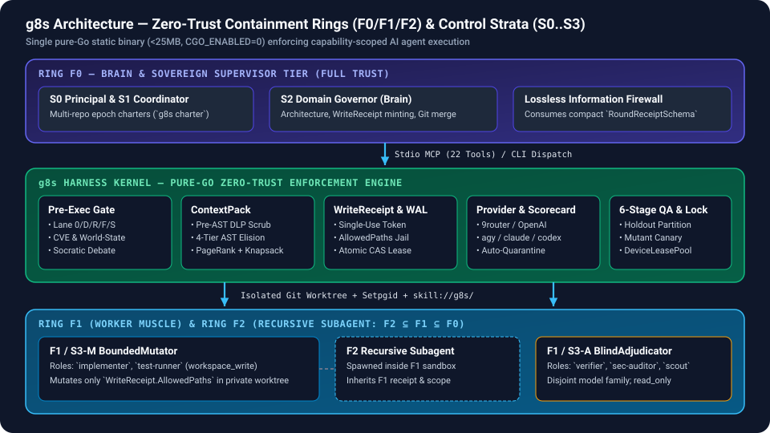
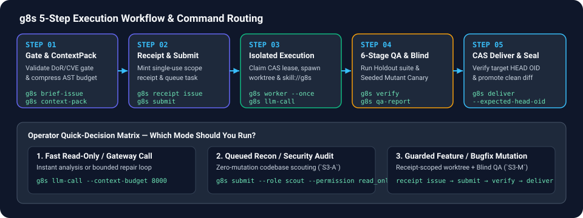

<p align="center">
  
</p>

# g8s (The Gatekeepers) — Bản tiếng Việt

> **Harness thực thi đa tầng zero-trust bằng binary tĩnh thuần Go (<25MB, không CGO) cho các AI agent CLI worker — kết hợp sandbox nhân OS (`Seatbelt` / `bwrap`+Landlock / `JobObject`), biên nhận mật mã Ed25519, và tường lửa Git worktree.**  
> *"k8s điều phối container tính toán của bạn; g8s điều phối các AI subagent của bạn."*

<p align="center">
  🌐 <a href="https://g8s.flowaxon.com"><b>g8s.flowaxon.com</b></a> — trang giới thiệu, product reel 36s, và <a href="https://g8s.flowaxon.com/gate-room.html">The Gate Room</a>: sảnh containment 3D tương tác, nơi luật lệ chính là vật lý.
</p>

[](LICENSE)
[](https://golang.org)
[](https://github.com/tamld/g8s)
[](https://github.com/tamld/g8s/releases)

<p align="center">
  <a href="README.md">English</a> | <b>Tiếng Việt</b>
</p>

*Bản tiếng Việt là bản tóm lược chuẩn mực. Bản kỹ thuật đầy đủ và cây cấu trúc tự động: [README.md](README.md).*

---

## 1. Tổng quan & Tại sao cần g8s?

Khi các AI agent tự hành (Claude, GPT, Codex, Gemini) thực thi công việc trên máy cục bộ, việc trao toàn quyền shell trực tiếp dễ dẫn đến sai sót nghiêm trọng: xóa nhầm file, sửa ngoài phạm vi cho phép, bỏ sót thay đổi, vòng lặp vô hạn và rò rỉ biến môi trường.

`g8s` giải quyết bài toán này bằng cách thiết lập **ranh giới zero-trust đối xứng** giữa mô hình tư duy chiến lược ("Brain") và các tiến trình thực thi cơ học ("Muscle"). Được đóng gói dưới dạng một binary tĩnh thuần Go duy nhất (zero CGO), `g8s` cách ly thực thi vào các Git worktree độc lập, kiểm soát quyền sửa file bằng biên nhận có phạm vi, và niêm phong bằng chứng bền vững.

### Khi không có g8s vs. Khi có g8s

| Chiều hướng | Khi không có g8s (Ambient Shell) | Khi có g8s (Zero-Trust Harness) |
| :--- | :--- | :--- |
| **Quyền hạn thực thi** | Trao toàn quyền máy chủ; worker có thể can thiệp bất kỳ đâu. | Cấu hình quyền theo role chặt chẽ (`read_only`, `workspace_write`). |
| **An toàn hệ thống file** | Thay đổi file trực tiếp làm hỏng working tree chính. | Biên nhận `WriteReceipt` ký Ed25519 (`rc1:`) dùng một lần, sandbox ghi ở nhân OS trên Unix (`Seatbelt` / `bwrap` / Landlock) và tường lửa diff worktree hậu kiểm (`VerifyWorktreeDiffScope`). |
| **Cách ly tiến trình** | Tiến trình con sót lại dưới dạng zombie khi crash; rò rỉ khóa API môi trường. | Lọc bí mật môi trường (`ScrubEnv`) + cô lập process group / JobObject OS (`Setpgid`, `Pdeathsig` với Landlock, Win32 `JobObject`). Xem [Ma trận Containment 3-OS](docs/security/containment-matrix.md). |
| **Tính bền vững của task** | Lưu trong bộ nhớ agent tạm bợ; mất khi ngắt kết nối. | Hàng đợi SQLite WAL với khóa Compare-And-Swap (CAS) nguyên tử. |
| **Truy cập Gateway LLM** | Dùng script Python chắp vá hoặc nền tảng cloud đóng kín. | Tiêu thụ gateway hướng cấu hình thuần Go (`g8s llm-call`, `9router`, OpenAI, Anthropic). |
| **Ngữ cảnh Supervisor** | Bị tràn ngập bởi hàng megabyte log thô kiểm thử / CI. | Tường lửa thông tin không suy hao (`RoundReceiptSchema` lọc nhiễu, giữ nguyên lỗi). |

### Bảng thuật ngữ cốt lõi

| Thuật ngữ | Định nghĩa kiến trúc |
| :--- | :--- |
| **Brain (`F0`)** | Orchestrator tầng cao (Claude 3.7 Sonnet / Opus, GPT-4o, Codex) giữ quyền tư duy và commit Git. |
| **Worker (`F1`)** | Tiến trình cơ học (`agy`, `codex`, `cursor`, `claude`, `gemini`, `opencode`, `qwen`, `ollama`, …) hoặc gateway consumer (`9router`, OpenAI, Anthropic) thực thi gói việc được giao. |
| **Subagent (`F2`)** | Subagent tạm thời được sinh đệ quy bởi F1, chia sẻ chung worktree và biên nhận của F1 (`F2 ⊆ F1 ⊆ F0`). |
| **Task** | Đơn vị công việc nguyên tử, bền vững nằm trong hàng đợi SQLite WAL kèm ngân sách và mã chống trùng. |
| **Receipt** | Biên nhận quyền ghi file: dùng một lần, có thời hạn và giới hạn vùng đường dẫn (`AllowedPaths`). |
| **Attempt** | Một lần chạy cụ thể của task, được cô lập trong một Git worktree và nhóm tiến trình riêng biệt. |
| **Evidence Lake** | Kho lưu trữ append-only niêm phong biên nhận, sự kiện quan sát viễn từ và diff thực tế trên đĩa. |

---

## 2. Kiến trúc & Vòng đời thực thi

`g8s` tổ chức cộng tác đa agent theo kiến trúc trực giao 2 trục (**Trục X**: Vòng cô lập `F0 / F1 / F2` theo [ADR-0032](docs/decisions/0032-containment-levels.md) $\times$ **Trục Y**: Phân tầng điều khiển `S0..S3 + O-Plane` theo [ADR-0035](docs/decisions/0035-orthogonal-stratum-federation.md)):

<p align="center">
  
</p>

### 5 bước vòng đời thực thi & Biểu đồ luồng trực quan

1. **Nạp & Kiểm cổng (Submit & Gate)**: Người vận hành / Brain (`F0`) kiểm tra brief (`g8s brief-issue --lane <0|D|R|F|S>`), nén ngữ cảnh (`g8s context-pack`), cấp biên nhận `WriteReceipt` (`g8s receipt issue`) và nạp task (`g8s submit`).
2. **Khóa (Lease)**: Worker (`F1`) nhận task qua khóa Compare-And-Swap (CAS) nguyên tử trong SQLite WAL (`g8s worker --once`).
3. **Cách ly & Hydrate (Contain & Hydrate)**: Harness tạo Git worktree riêng, nhóm tiến trình OS (`Setpgid`), và nạp skill gắn mã băm (`skill://g8s/<tier>/<name>`).
4. **Kiểm chứng 6 tầng (Verify & QA Audit)**: Cổng kiểm chứng (`g8s verify` & `g8s qa-report`) chạy bộ test thực tế, holdout độc lập và canary đột biến, xuất `RoundReceiptSchema` qua Tường lửa thông tin.
5. **Niêm phong & Giao nhận CAS (Seal & Deliver)**: Kết quả niêm phong vào receipt; Brain kiểm tra diff và hợp nhất an toàn qua `g8s deliver --expected-head-oid <sha>`.

<p align="center">
  
</p>

---

## 3. Năng lực cốt lõi

| Lĩnh vực | Năng lực kiến trúc | Bề mặt chính |
| :--- | :--- | :--- |
| **Cách ly Zero-Trust** | Biên nhận `WriteReceipt` dùng 1 lần, process group POSIX, và Git worktree riêng biệt. | `g8s receipt issue`, `g8s worker` |
| **Hàng đợi bền vững** | Lưu trữ SQLite WAL, khóa CAS nguyên tử, chống trùng lặp idempotency, và tự động thử lại. | `g8s submit`, `g8s watch`, `g8s status` |
| **I/O Agent & ContextPack** | Tìm kiếm đa nền tảng (`search`), đọc giới hạn (`read`), sửa CAS (`edit`), trích xuất JSON (`select`), và nén ngữ cảnh AST 4 tầng + PageRank + Knapsack (`context-pack`). | `g8s search`, `g8s read`, `g8s edit`, `g8s select`, `g8s context-pack` |
| **Tiêu thụ Gateway LLM** | Thực thi CLI đồng bộ (`llm-call`) và hàng đợi worker cho OpenAI/Anthropic/9Router kèm bảng điểm chất lượng model & tự động cách ly. | `g8s llm-call`, `g8s providers discover`, `g8s providers scorecard` |
| **QA AI 6 Tầng & Blind Verify** | Chuẩn hóa BA-to-Spec, cô lập Holdout, kiểm thử đột biến Canary và kiểm toán nhận thức luận (`MECHANICAL_VERIFIED` vs `UNVERIFIED_PROSE`). | `g8s verify`, `g8s qa-report` |
| **Kho tri thức tách rời** | Đánh chỉ mục FTS5 + xếp hạng BM25 sub-millisecond trong SQLite cho quyết định kiến trúc và spatial whisper JIT. | `g8s vault store`, `g8s vault query` |

---

## 4. Cài đặt

`g8s` được phân phối dưới dạng một file binary tĩnh duy nhất (<25MB), không yêu cầu cài thêm runtime nào khác. Chọn một đường dẫn cài đặt dưới đây; các bản phát hành cũng kèm `checksums.txt`, `checksums.txt.sigstore.json`, và file SPDX SBOM cùng với từng nén ([GitHub Releases](https://github.com/tamld/g8s/releases)).

### Cài đặt một dòng (khuyên dùng)

**macOS / Linux:**

```bash
curl -fsSL https://raw.githubusercontent.com/tamld/g8s/main/scripts/install.sh | bash
```

**Windows (PowerShell):**

```powershell
irm https://raw.githubusercontent.com/tamld/g8s/main/scripts/install.ps1 | iex
```

Bộ cài tự động phát hiện kiến trúc CPU, tải bản phát hành phù hợp, và **thất bại an toàn** về tính toàn vẹn: chúng yêu cầu xác minh SHA-256 dựa trên `checksums.txt` từ bản phát hành (qua `sha256sum` / `shasum` trên Unix, hoặc `Get-FileHash` trên Windows) và từ chối cài đặt nếu không có công cụ checksum hoặc xác minh thất bại. Xem thêm [Hướng dẫn cài đặt Windows](docs/WINDOWS_INSTALL.md).

### Trình quản lý gói

**macOS / Linux (Homebrew):**

```bash
brew install tamld/g8s/g8s
```

[Tap tamld/g8s](https://github.com/tamld/homebrew-g8s) cung cấp binary biên dịch sẵn (universal trên macOS; amd64/arm64 trên Linux) và tự động cập nhật trong vòng một giờ sau mỗi bản phát hành, lấy checksum từ `checksums.txt` của bản phát hành.

**Windows (Scoop):**

```powershell
scoop bucket add tamld https://github.com/tamld/scoop-bucket
scoop install tamld/g8s
```

[Bucket Scoop tamld](https://github.com/tamld/scoop-bucket) cung cấp binary Windows amd64/arm64 với hash từ `checksums.txt` của bản phát hành và cùng nhịp tự động cập nhật hàng giờ.

**Gói Linux (từ trang phát hành):** chưa có kho `apt`/`yum`/`apk` chính thức — tải gói cho kiến trúc của bạn từ [trang phát hành](https://github.com/tamld/g8s/releases) và cài đặt cục bộ:

| Kiến trúc | `.deb` | `.rpm` | `.apk` |
| :--- | :--- | :--- | :--- |
| `linux/amd64` | `g8s_<version>_linux_amd64.deb` | `g8s_<version>_linux_amd64.rpm` | `g8s_<version>_linux_amd64.apk` |
| `linux/arm64` | `g8s_<version>_linux_arm64.deb` | `g8s_<version>_linux_arm64.rpm` | `g8s_<version>_linux_arm64.apk` |

```bash
sudo dpkg -i g8s_*_linux_amd64.deb          # Debian/Ubuntu
sudo rpm -i g8s_*_linux_amd64.rpm             # RHEL/Fedora
sudo apk add --allow-untrusted ./g8s_*_linux_amd64.apk   # Alpine
```

### Nén (tất cả nền tảng)

| Nền tảng | Mẫu file phát hành |
| :--- | :--- |
| macOS (universal) | `g8s_<version>_darwin_all.tar.gz` |
| Linux | `g8s_<version>_linux_{amd64,arm64}.tar.gz` (cùng gói ở trên) |
| Windows | `g8s_<version>_windows_{amd64,arm64}.zip` |

Giải nén và đặt `g8s` lên `PATH`, hoặc dùng bộ cài một dòng.

### Qua Go Toolchain (`go1.26.11`+)

```bash
go install github.com/tamld/g8s/cmd/g8s@latest
```

### Biên dịch từ mã nguồn

```bash
git clone https://github.com/tamld/g8s.git
cd g8s
make local
./bin/g8s doctor --json
```

### Xác minh tải về

1. **SHA-256 (bắt buộc):** So sánh hash nén với dòng tên file trong `checksums.txt` trên bản phát hành. Bộ cài một dòng thực hiện tự động bước này.
2. **Chứng thực GitHub (tùy chọn):** `gh attestation verify <asset> -R tamld/g8s --owner tamld` chứng minh artifact phát hành liên kết mật mã với nguồn build của repo này.
3. **Gói Sigstore (tùy chọn):** `cosign verify-blob --bundle checksums.txt.sigstore.json checksums.txt` chứng minh manifest checksum được ký trong gói Sigstore của bản phát hành.

Nếu cài đặt thất bại hoặc cần khôi phục binary, xem [Khôi phục phiên bản (Rollback)](docs/release/ROLLBACK.md).

### Sau khi cài đặt

- **`g8s init`** — thiết lập lần đầu tương tác hoặc headless (đường dẫn, gợi ý MCP).
- **`g8s doctor`** — kiểm tra sức khỏe binary, cấu hình, môi trường.
- **`g8s update`** — nâng cấp lên bản phát hành mới hơn với thay thế binary đã xác minh.
- **`g8s uninstall`** — gỡ binary đã cài (tùy chọn dọn state).

Các bề mặt vòng đời khác bao gồm `g8s service install|start|status` và `g8s version`.

---

## 5. Mô phạm sử dụng (Quickstart)

### Paradigm 1: Trinh sát chỉ đọc (Read-Only Reconnaissance)
Duyệt và thu thập thông tin codebase an toàn tuyệt đối mà không cấp quyền ghi:
```bash
# Nạp task trinh sát với quyền chỉ đọc
g8s submit \
  --role scout \
  --permission read_only \
  --prompt "Khảo sát internal/provider và liệt kê các interface xuất khẩu"

# Chạy một lượt worker để xử lý task
g8s worker --once
```

### Paradigm 2: Đột biến giới hạn quyền (Capability-Scoped Mutation)
Cấp biên nhận dùng 1 lần khóa chặt đường dẫn trước khi sửa đổi:
`--allow-workspace-write` tạm thời đặt `AGY_MCP_ALLOW_WORKSPACE_WRITE=1` cho một lần gọi CLI đó. Nếu bỏ qua hoặc đặt false, giá trị biến môi trường hiện có không đổi; vẫn hỗ trợ `AGY_MCP_ALLOW_WORKSPACE_WRITE=1` đã có sẵn.

```bash
# 1. Cấp biên nhận ghi có thời hạn cho thư mục chỉ định
RECEIPT_ID=$(g8s receipt issue --path "internal/config/*.go" --json | g8s select --selector .data.receipt_id)

# 2. Giao task cho worker kèm mã biên nhận
g8s submit \
  --idempotency-key "test-config-01" \
  --role test-runner \
  --permission workspace_write \
  --allow-workspace-write \
  --receipt-id "$RECEIPT_ID" \
  --prompt "Thêm unit test kiểm tra validate config trong internal/config"

g8s worker --once --allow-workspace-write
```

### Paradigm 3: Tiêu thụ Gateway LLM hướng cấu hình (Config-Driven LLM Consumer)
Gọi trực tiếp hoặc nạp task qua hàng đợi tới các gateway LLM (OpenAI, Anthropic, 9Router):
```bash
# Gọi trực tiếp đồng bộ với cấu hình effort suy luận
g8s llm-call \
  --provider 9router \
  --model reasoning-high \
  --effort high \
  --prompt "Rà soát race condition trong internal/fsops"

# Khám phá danh sách model trực tiếp từ gateway
g8s providers discover --provider 9router --json
```

### Paradigm 4: I/O Agent thuần Go đa nền tảng
Thay thế toàn bộ công cụ shell ngoài bằng các lệnh thuần Go hiệu năng cao:
```bash
# Tìm kiếm trong kho mã nguồn (thay thế rg / grep / find)
g8s search "WriteReceipt" --globs "*.go"

# Đọc file có giới hạn dòng kèm mã băm SHA-256 (thay thế sed -n / cat)
g8s read internal/provider/registry.go --lines 20:50

# Sửa file nguyên tử compare-and-swap (thay thế sed -i / awk)
g8s edit internal/config/config.go --old "timeout = 30s" --new "timeout = 60s"

# Trích xuất giá trị JSON dot-path (thay thế jq)
cat result.json | g8s select --selector .data.status
```

---

## 6. Tích hợp MCP, Agent Skills & Offer Bundle

### Model Context Protocol (MCP) Server

`g8s` khởi chạy như một MCP server stdio chuẩn cho các IDE AI (Claude Desktop, Cursor, Windsurf, Antigravity):

```bash
g8s mcp
```

#### Danh mục 23 công cụ MCP đã đăng ký (22 hoạt động + `g8s_run` dự trữ)

| Tên công cụ | Mục đích & Thao tác |
| :--- | :--- |
| `g8s_run` | Stub thực thi đồng bộ dự trữ hậu MVP (trả lỗi JSON-RPC `-32603`; dùng `g8s_submit`). |
| `g8s_submit` | Nạp một task bền vững với role, quyền và ngân sách thời gian. |
| `g8s_get` | Tra cứu trạng thái task đã làm sạch theo `task_id`. |
| `g8s_receipt_issue` | Cấp biên nhận ghi có phạm vi đường dẫn và thời hạn dùng một lần. |
| `g8s_self_awareness` | Báo cáo danh sách provider, model khả dụng và số slot đồng thời. |
| `g8s_blast_radius` | Phân tích phạm vi ảnh hưởng AST thuần Go và CodeIntel đa tầng cho file/symbol (`DELTA-07`, `DELTA-20`). |
| `g8s_dispatch` | Thực thi lệnh dispatch chỉ đọc qua lớp bọc an toàn. |
| `g8s_list_tasks` | Liệt kê danh sách task theo trạng thái (`QUEUED`, `SUCCEEDED`, v.v.). |
| `g8s_cancel_task` | Yêu cầu hủy task hợp tác kèm lý do kiểm toán. |
| `g8s_list_roles` | Liệt kê toàn bộ 10 role worker chuẩn cùng quyền mặc định. |
| `g8s_list_permissions` | Liệt kê các profile quyền hạn (`read_only`, `automation_read`, `workspace_write`, `supplied_text`). |
| `g8s_search` | Tìm kiếm regex và chuỗi ký tự thuần Go tôn trọng `.gitignore` (`DELTA-22/23`). |
| `g8s_read` | Đọc giới hạn dòng file và xác thực mã băm SHA-256 an toàn (`DELTA-23`). |
| `g8s_edit` | Chỉnh sửa file nguyên tử CAS bảo toàn định dạng xuống dòng CRLF/LF (`DELTA-23`). |
| `g8s_select` | Trích xuất giá trị JSON qua đường dẫn dot-path (thay thế `jq`; `DELTA-23`). |
| `g8s_llm_call` | Thực thi gọi LLM đồng bộ trực tiếp tới gateway được khai báo (`DELTA-25`). |
| `g8s_charter_issue` | Cấp phát Stratum Charter gắn epoch & fence token (`S0/S1 -> S2`; `DELTA-33`). |
| `g8s_charter_verify` | Xác thực epoch và fence token của Stratum Charter (`DELTA-33`). |
| `g8s_portfolio_status` | Chiếu trạng thái O-Plane chỉ đọc của các Stratum Charter liên repo (`DELTA-33`). |
| `g8s_skills_list` | Liệt kê danh mục skill gắn mã băm (`skill://g8s/<tier>/<name>`) theo tầng F0/F1/F2 (`DELTA-34`). |
| `g8s_skills_read` | Đọc `SKILL.md` có kiểm tra chống giả mạo TOCTOU qua `expected_digest` SHA-256 (`DELTA-34`). |
| `g8s_context_pack` | Nén ngữ cảnh AST 4 tầng thuần Go, PageRank + BM25F và Knapsack (`DELTA-36`). |
| `g8s_coordinator_mesh` | Thực thi các thao tác sổ cái SQLite WAL liên peer coordinator với thư mục tường minh (`DELTA-46`). |

### Agent Skills & Hiến chương Giám sát

Hiến chương chuẩn cho giám sát viên `g8s` được lưu tại [`skills/g8s-supervisor/SKILL.md`](skills/g8s-supervisor/SKILL.md) (`v4.3.0`), đăng ký trong [`skills/manifest.json`](skills/manifest.json), và tuân thủ tiêu chuẩn tài liệu [`skills/g8s-supervisor/references/doc-standard.md`](skills/g8s-supervisor/references/doc-standard.md).

### Áp dụng cho Repo khác qua Offer Bundle

Các dự án khác có thể tích hợp `g8s` thông qua Offer Bundle ([`offer/README.md`](offer/README.md)) gồm 4 hồ sơ miền ([`knowledge`](offer/profiles/knowledge.md), [`security`](offer/profiles/security.md), [`infra`](offer/profiles/infra.md), [`utility`](offer/profiles/utility.md)) và 3 cổng đồng bộ CI.

> [!NOTE]
> **Điểm khám phá cho AI Agent**: Agent tự hành vào repo này nên đọc [`manifest.json`](manifest.json) để lấy schema máy đọc được và [`AGENTS.md`](AGENTS.md) để nắm thứ tự đọc 5 bước.

---

## 7. Giới hạn phạm vi (Non-Goals)

Để duy trì tốc độ và độ tin cậy tối đa, `g8s` vạch rõ các ranh giới không làm:

| Lĩnh vực | Quyết định kiến trúc & Non-Goal |
| :--- | :--- |
| **Plugin động in-process** | **Non-Goal**: Không dùng plugin dynamic C/Go. `g8s` chọn **Cấu hình khai báo + Giao thức chuẩn** (`providers.json`, JSON-RPC MCP, tiến trình con) để loại bỏ rủi ro biên dịch runtime và thoát sandbox. |
| **Framework nặng nề** | **Non-Goal**: Không phụ thuộc vào môi trường Python cồng kềnh (LangChain, AutoGen). `g8s` là binary Go tĩnh hoàn toàn độc lập. |
| **Web UI cồng kềnh** | **Non-Goal**: Không dựng web dashboard rườm rà. `g8s` ưu tiên CLI; mọi trạng thái được theo dõi qua Evidence Lake và JSON envelope. |
| **Hosting Model Inference** | **Non-Goal**: Không nạp trọng số model trực tiếp trong tiến trình g8s. g8s điều phối tiến trình ngoài và gateway HTTP. |

---

## 8. Bản đồ tài liệu & Bảo chứng chất lượng

### Bản đồ tài liệu chính

| Hướng dẫn / Đặc tả | Trọng tâm nội dung |
| :--- | :--- |
| [Trang giới thiệu sản phẩm](https://g8s.flowaxon.com) | Landing page, product reel, và The Gate Room demo containment tương tác. |
| [Hướng dẫn Quickstart](docs/quickstart.md) | Khởi đầu từ cài đặt đến lần ủy quyền thực thi đầu tiên. |
| [Cài đặt trên Windows](docs/WINDOWS_INSTALL.md) | PowerShell installer, `PATH`, và troubleshooting cài đặt Windows. |
| [Tra cứu lệnh CLI](docs/user-guide/cli-reference.md) | Sổ tay đầy đủ về mọi lệnh con, cờ tùy chọn và mã thoát. |
| [Tài liệu MCP Tools](docs/user-guide/mcp-tools.md) | Schema JSON, tham số và kiểu dữ liệu trả về của 23 MCP tool đã đăng ký. |
| [Hướng dẫn I/O Agent](offer/SEARCH_GUIDE.md) | Tìm kiếm, cắt dòng, sửa nguyên tử và trích xuất JSON dot-path. |
| [Đặc tả Sản phẩm (PRD)](docs/PRD.md) | Vấn đề giải quyết, đối tượng hướng tới và giá trị cốt lõi. |
| [Yêu cầu Phần mềm (SRS)](docs/SRS.md) | Yêu cầu chức năng (FR-1..11) và phi chức năng (NFR-1..4). |
| [Định nghĩa Xong & Sẵn sàng (DOD_DOR)](docs/DOD_DOR.md) | Tiêu chuẩn chất lượng, quy trình xác thực đa vòng và cổng kiểm soát. |
| [Chuẩn Bảo mật OWASP Agentic, SLSA & SBOM](docs/security/owasp-agentic-slsa-sbom.md) | Ánh xạ OWASP Top 10 cho LLM/Agent (2025), SLSA v1.0 và SPDX SBOM. |
| [Ma trận Containment & Threat Model 3-OS](docs/security/containment-matrix.md) | Ranh giới thực thi nhân OS vs. Ed25519/CAS vs. Tường lửa diff worktree, chế độ suy giảm và hướng dẫn tái lập benchmark offline. |
| [Khôi phục Phiên bản (Rollback)](docs/release/ROLLBACK.md) | Khôi phục binary bản phát hành trước khi nâng cấp thất bại. |
| [Sổ ghi Quyết định (ADR)](docs/decisions/) | Lịch sử các quyết định kiến trúc từ ADR-0001 đến ADR-0041 (kèm ghi chú tombstone). |

### 4 trụ cột cổng chất lượng & AppSec

Mọi commit đều được kiểm tra nghiêm ngặt qua 4 trụ cột AppSec và các khẳng định định lượng đăng ký tại [`docs/claims.yml`](docs/claims.yml):

| Trụ cột | Cơ chế bảo đảm chất lượng | Mục tiêu kiểm chứng |
| :--- | :--- | :--- |
| **1. SAST Triad** | `gosec` (trong `golangci-lint`) + `Semgrep` (`.semgrep/g8s-rules.yml`) + `CodeQL` | Không có lỗ hổng bảo mật, bắt buộc xử lý mọi lỗi (`errcheck`). |
| **2. Black-Box DAST** | Fuzzing API và thăm dò biên giới hạn (`dast_test.go`) | Kiểm tra endpoint HTTP và MCP stdio chống payload độc và thoát thư mục. |
| **3. In-Process IAST** | `probe.RuntimeSensor` (`internal/harness/probe`) và bộ probe red-team (`sa-006`..`sa-008`) | Snapshot kiểm định vệ sinh runtime xác minh tranh chấp CAS, giam giữ symlink và không rò rỉ goroutine/file tạm. |
| **4. Grey-Box Fuzzing** | Go native fuzzing (`FuzzVerifyScope`, `FuzzReadAndEdit`, `FuzzSelectPath`) | Độ bền vững của bộ phân tích trước mọi đầu vào bất thường. |

### Ranh giới Containment & Bộ Benchmark Độc lập Offline (`#922`)

Tái lập độc lập toàn bộ 5 bài đo containment thoát sandbox, chống `False PASS` bằng canary đột biến, phục hồi lease crash, độ trễ CAS và kiểm toán mật mã Ed25519 mà không cần bất kỳ API key LLM nào:

```bash
bash tools/assurance_benchmark.sh
```

Chi tiết ma trận 3 hệ điều hành (`macOS`, `Linux`, `Windows`) và các giới hạn không cam kết: [`docs/security/containment-matrix.md`](docs/security/containment-matrix.md).

---

## 9. Lộ trình, Cấu trúc dự án & Giấy phép

### Lộ trình phát triển thực tế (Evidence-Gated)

Mọi mốc phát triển được nghiệm thu dựa trên bằng chứng kiểm thử và kiểm chứng vận hành thực tế:

| Mốc phiên bản | Phạm vi & Năng lực nghiệm thu | Trạng thái |
| :--- | :--- | :---: |
| **`v0.18.0`** (2026-10-21) | **F0 Verified Delegation & Symmetric Zero-Trust Control Plane** ([ADR-0033](docs/decisions/0033-f0-verified-delegation.md)): sổ cái bằng chứng hash-chain, mandate T0–T4, gates G0–G7, tường lửa verify không suy hao. | **Xong** |
| **`v0.19.0`** (2026-10-21) | **Universal Config-Driven LLM Call Consumer & Multi-Model Fleet** ([ADR-0034](docs/decisions/0034-config-driven-llm-consumer-9router.md), `DELTA-25`): `g8s_llm_call`, `g8s_select`, Offer Bundle `v0.19.0`, Skills `v4.3.0` (`doc-standard.md`), đơn giấy phép `MIT`, và `manifest.json` chuẩn hóa. | **Xong** |
| **`v0.20.0`** (2026-10-25) | **Liên bang Phân tầng Trực giao, Thẻ điểm Chất lượng Model, Hydrate Skill Gắn Mã Băm, Nén Ngữ cảnh AST/Knapsack, Pipeline QA AI 6 Tầng & DeviceLeasePool** ([ADR-0035](docs/decisions/0035-orthogonal-stratum-federation.md), `DELTA-26..38`): động cơ charter `S0..S3` + `O-Plane`, mở rộng MCP server (`g8s_skills_list`, `g8s_skills_read`, `g8s_context_pack`, `g8s_charter_*`), 10 role chuẩn, chẩn đoán lỗi `FailureDiagnosis` & tự động cách ly, CAS `deliver --expected-head-oid`, cổng tiền thực thi `Lane F/R/S`, `g8s context-pack`, `g8s qa-report` và `DeviceLeasePool`. | **Xong** |
| **`v0.21.0`** (2026-10-27) | **Bộ Adapter CLI Agent Toàn Diễn & Tích hợp Cursor Hai Đường** (`DELTA-39..45`, [#672](https://github.com/tamld/g8s/issues/672)): adapter CLI worker hạng nhất cho `opencode`, `commandcode`, `qwen`, `codex`, và `cursor` (khám phá Cursor Cloud REST qua `CURSOR_API_KEY` + `cursor-agent` headless cục bộ), tường lửa `diff_firewall` worktree thất bại an toàn trên đột biến ngoài phạm vi (`E_OUT_OF_SCOPE_MUTATION`), Spec-Kit v2 với 8 spec miền sống (triển khai lò lửa 40-repo), hợp đồng bề mặt CLI generative v2 (`E_UNBOUND_CLI_CLAIM`), bus telemetry thống nhất + thẻ điểm Kaizen 5 trục, nhật ký truy cập doanh nghiệp giao dịch, và nạp skill/MCP theo phạm vi năng lực. | **Xong** |
| **`v0.22.0`** (2026-11-01) | **Sổ cái Liên hợp Coordinator Đa nền tảng & RT-MESH v1** (spec `46-peer-coordinator-ledger-spec.md`, `DELTA-46`): sổ cái SQLite WAL chung cho các coordinator F0 ngang hàng (`register`/`quota-publish`/`send`/`inbox`/`ack`/`claim`/`release`/`accept`/`snapshot`/`wait` qua CLI + công cụ MCP `g8s_coordinator_mesh`), tin nhắn có kiểu chống trùng lặp (`message_id` UNIQUE + echo theo digest), CAS claim với TTL + hàng rào context-revision, long-poll `wait` có biên, tự báo quota 2 tầng (không biết thì nói không biết), miễn nhiễm whitespace cho layer-gate (A6), workflow full-battery hằng đêm; được phê chuẩn chéo bởi các peer Codex/AGY/ZCode với trao đổi 3 nền tảng thật ([#700](https://github.com/tamld/g8s/pull/700), [#701](https://github.com/tamld/g8s/pull/701), [#702](https://github.com/tamld/g8s/pull/702), tracker [#699](https://github.com/tamld/g8s/issues/699)). **+ Tầng thu thập dữ liệu đa nền tảng ("reach")** — chuỗi tool fallback có thứ tự theo platform (`g8s reach read`), sổ cái sức khỏe & đường dẫn sở hữu (`S2`), cấp dữ liệu cho Context Broker `WorldSnippets` và thăng cấp vào vault ở trạng thái `PROPOSED` (`S3`), cùng artifact nghiên cứu lấy bằng máy (`S4`) ([#704](https://github.com/tamld/g8s/issues/704), [ADR-0037](docs/decisions/0037-reach-layer.md), `DELTA-47`). | **Xong** |
| **`v0.23.0`** (2026-11-08) | **Gia cố Cô lập, Cơ giới hóa SSoT & Phản tỉnh Quy trình** ([ADR-0038](docs/decisions/0038-mesh-fence-enforcement-point.md), [ADR-0039](docs/decisions/0039-dogfooding-honesty-ledger.md), [ADR-0040](docs/decisions/0040-mechanized-ssot.md), [ADR-0041](docs/decisions/0041-worker-git-proxy.md)): hàng rào ghi gắn claim đầu-cuối, `RT-MESH v1.1` (`A1..A5`), khép kín chu trình phản xạ `D-09` (`SENSE->JUDGE->ACT`), sổ cái liêm chính dogfooding, cơ giới hóa kiểm định SSoT và proxy git-commit cho worker. | **Xong** |
| **`v0.24.0`** (2026-11-15) | **Tiếp nhận Model Khai báo, Control Plane Trung lập Adapter & Đóng gói Zero-Implicit-Default** (`DELTA-48`, [#893](https://github.com/tamld/g8s/issues/893), [#894](https://github.com/tamld/g8s/issues/894), [#902](https://github.com/tamld/g8s/issues/902), [#904](https://github.com/tamld/g8s/pull/904), [#905](https://github.com/tamld/g8s/issues/905), [#906](https://github.com/tamld/g8s/issues/906), [#907](https://github.com/tamld/g8s/issues/907)): Onboarding Gemini 4 Element Series & catalog `.g8s/agent-models.yml` v3 (`status`, `replacement`, `sunset_at`), điều phối adapter-neutral đối xứng qua `9router`/`opencode`/`codex`/`claude`/`cursor`/`agy`, `ResolveProviderDefaultModel` dọn dẹp mặc định `gemini-3.8-*` lỗi thời, kế thừa timeout profile catalog trên triple tường minh, fallback `g8s verify` nhận biết scope, stamping phiên bản MCP server động, skill xác thực cơ giới hóa `gate_command` SSoT, và che giấu DLP lỗi probe RFC1918. | **Xong** |
| **`v0.25.0`** (2026-11-18, Hiện tại) | **Sandbox Cấp Nhân 3 Hệ Điều Hành, Biên Nhận Mật Mã Ed25519 & Benchmark Kiểm Định Offline** (`DELTA-49`, Epic [#923](https://github.com/tamld/g8s/issues/923), [#916](https://github.com/tamld/g8s/issues/916)–[#922](https://github.com/tamld/g8s/issues/922)): Cách ly subprocess bằng macOS Seatbelt / Linux `bwrap`+Landlock / Windows `JobObject` kèm `ScrubEnv` (`internal/sandbox`), chữ ký Ed25519 cho `WriteReceipt` & `StratumCharter` cùng chuẩn quyền `0600`/`0700` (`internal/signing`, `internal/pathutil`), khóa cổng `SUPERVISOR_ACCEPTED` cho `deliver` + `ReviewReceipt`/`RealReviewer` fail-closed + tường lửa git rename `-z`, E2E fault-injection `tools/faultworker` 3 HĐH + probe `os_sandbox` trong `g8s doctor`, kiểm toán feature `19/19 RUNTIME_PROVEN` + 14 ranh giới trust-boundary + tự động leo thang `Lane S`, và bộ benchmark offline `as-001`..`as-005` kèm [`docs/security/containment-matrix.md`](docs/security/containment-matrix.md). | **Xong** |
| **`v0.30.0`** (Kế hoạch) | **Proxy Phân quyền MCP F0/F1/F2 & Vận hành Thực chiến Offer Đa Repo** ([#672](https://github.com/tamld/g8s/issues/672); các adapter CLI ngoài và tường lửa worktree `read_only` của `DELTA-39` đã phát hành từ `v0.20.0+`): proxy giới hạn năng lực MCP theo biên nhận trong worktree F1/F2 và kiểm chứng giữ chân Offer Bundle 90 ngày trên đa repo. | **Kế hoạch** |
| **`v0.40.0`** (Kế hoạch) | **Cổng Tiền thực thi Mật mã học & Đồng thuận Phản biện Đa tác tử**: biên nhận nghiên cứu CVE/NVD & phản biện Socratic bắt buộc trước khi cấp `WriteReceipt` cùng chứng thực SLSA/SBOM. | **Kế hoạch** |
| **`v1.0.0`** (GA Nghiệm thu Bằng chứng) | **Khóa Chuẩn Sản xuất GA**: nghiệm thu khi hoàn tất `v0.30.0` + `v0.40.0` và vượt qua **$\ge 50$ lượt thực thi thực tế có biên nhận** trên cả 4 hồ sơ miền chuẩn của Offer Bundle (`knowledge`, `security`, `infra`, `utility`) với **0 lỗi P0 lọt lưới** và **$\ge 90\%$ First-Pass Yield**. | **Kế hoạch** |

### Cấu trúc dự án

Cây cấu trúc thư mục tự động kết xuất từ filesystem trực tiếp: xem [README.md](README.md) mục *Project Structure*.

---

## 10. Giấy phép (License)

Phân phối theo **MIT License**. Copyright (c) 2026 TamLD. Xem chi tiết tại [LICENSE](LICENSE).
