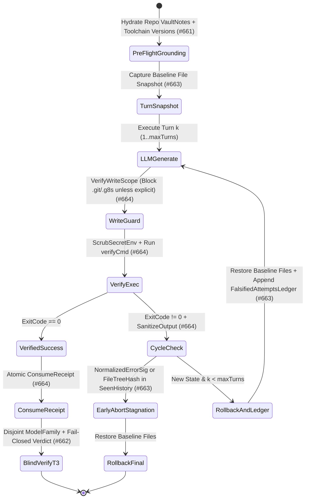

# Implementation Plan: Epistemic Loop, Multi-Project Vault Partitioning, Lineage-Disjoint Blind Verifier & Sandbox Hardening (`#661`, `#662`, `#663`, `#664`)

- **Date**: 2026-10-24
- **Session type**: T2 (execution)
- **Status**: COMPLETED
- **Issues**: [`#661`](https://github.com/tamld/g8s/issues/661), [`#662`](https://github.com/tamld/g8s/issues/662), [`#663`](https://github.com/tamld/g8s/issues/663), [`#664`](https://github.com/tamld/g8s/issues/664)
- **Governance Protocols Applied**: `wiki-deep-why`, `wiki-diagnostician`, `wiki-socratic`, `fable-thinking`, `ck:plan`, `ck:cook`

---

## 1. Three-Layer Cognitive Descent (`wiki-deep-why`: WHAT -> HOW -> WHY)

- **Level 1 (WHAT)**:
  - Resolve the four verified root causes across multi-project knowledge storage (`#661`), anti-sycophancy/blind verification (`#662`), non-Markovian loop convergence with atomic turn rollback (`#663`), and `--verify-cmd` / `--apply-files` sandbox security (`#664`).
- **Level 2 (HOW)**:
  - Enforces **Axiom 1 (Two-Tier Governance)**, **Axiom 2 (Zero-Trust Capability Receipts)**, **Axiom 4 (Process & State Containment)**, and the **4 Epistemic Laws** (`g8s-epistemic-audit`, `g8s-blind-verifier`).
- **Level 3 (WHY)**:
  - `system_exists_because`: `g8s` is the Zero-Trust microkernel coordinating heterogeneous AI workers across multiple repositories without exhausting F0 cognitive context or leaking secrets.
  - `task_triggered_by`: Socratic inspection revealed that our initial brainstorm proposals were Level-1 surface patches (e.g., adding a column to `vault.db` without noticing `VaultNotes` are never injected before worker execution; checking provider names instead of resolved model families; hashing raw stderr without normalizing timestamps/hex addresses or rolling back failed turn file mutations).
  - `unlocks`: True multi-project learning without cross-repo context bleed, falsification-first cross-family blind verification, guaranteed non-oscillating repair loops, and zero secret exfiltration through `--verify-cmd`.
  - `if_skipped`: Workers remain blind to project lessons during execution, `9router` combos silently route verifiers to the same model family as authors, repair loops oscillate `A -> B -> A` leaving broken files on disk, and untrusted test code in `--verify-cmd` can exfiltrate `os.Environ()` API keys back into cloud LLM prompts.

---

## 2. Six-Question Diagnostic Root Cause Analysis (`wiki-diagnostician`)

1. **Q1 — What Exists / Changed Recently?**
   - `DELTA-25..32` (`v0.20.0`) introduced `cmd/g8s/llm_call.go` (`--apply-files`, `--max-turns`, `--verify-cmd`), `tools/f0/verifier_t3.go` (`RunT3Verification`), `internal/verifier/blind_packet.go`, and `internal/vault/vault.go`.
2. **Q2 — Why Now? (Exact Code-Level Root Causes)**
   - **RCA-1 (`#661` — The Post-Mortem Vault Trap & Unpartitioned Store)**:
     - In [`internal/worker/worker.go:1507-1551`](../../internal/worker/worker.go#L1507-L1551), `ContextBroker.Assemble()` (`VaultNotes`) is only called at **L3 post-run** (after the child process has already exited) to feed `Jev`. Neither `worker.RunOnce` nor [`cmd/g8s/llm_call.go`](../../cmd/g8s/llm_call.go) hydrates `VaultNotes` or runtime versions (`go.mod` / `package.json`) into the worker prompt **before** execution. Furthermore, [`internal/vault/vault.go:148-164`](../../internal/vault/vault.go#L148-L164) has no `repo_id` or `scope_tier` (`repo` | `domain` | `global`), causing cross-project context bleed when sharing one `g8s` runtime.
   - **RCA-2 (`#662` — Split-Brain Fail-Open T3 Verifier & Combo-Masked Model Family)**:
     - In [`tools/f0/verifier_t3.go:276-310`](../../tools/f0/verifier_t3.go#L276-L310), `defaultT3ProviderRunner` sends a truncated 12KB diff without `SpecContract` or `Invariants`, and lines `306-310` default to `return true` (`PASS`) whenever the output does not contain `VETO` or `FAIL` — even if `VERDICT: PASS` is absent or the response is empty/malformed! Moreover, `SelectIndependentProviders` compares provider strings (`agy` vs `9router`) rather than the actual `model_resolved` family (`anthropic`, `openai`, `google`, `qwen`, `deepseek`, `zhipu`, `nvidia`).
   - **RCA-3 (`#663` — Markovian Oscillation `A -> B -> A` & Dirty File Residue)**:
     - In [`cmd/g8s/llm_call.go:508-511`](../../cmd/g8s/llm_call.go#L508-L511), Turn $k$ overwrites `spec.Brief` with only Turn $k-1$, forgetting Turns $1..k-2$ and enabling `A -> B -> A` oscillation. Raw stderr hashing fails because timestamps, durations (`0.04s`), temp paths, and hex pointers (`0xc000...`) change on every run. Worse, files written during failed Turn $k$ (`llm_call.go:455-481`) are never rolled back before Turn $k+1$.
   - **RCA-4 (`#664` — `--verify-cmd` Secret Oracle, `.git/.g8s` Tampering & Unconsumed Direct Receipts)**:
     - In [`cmd/g8s/llm_call.go:493-511`](../../cmd/g8s/llm_call.go#L493-L511), `vCmd` inherits raw `os.Environ()` (`OPENAI_API_KEY`, `G8S_SERVE_TOKEN`, `GITHUB_TOKEN`) and appends `vOutStr` into the next turn's cloud LLM prompt without `dispatch.SanitizeOutput`. Additionally, `fsops.VerifyScope` allows overwriting `.git/**` and `.g8s/**` when `allowedPaths` is `**` or empty, and standalone `llm-call --apply-files --receipt-id` never calls `ConsumeReceipt`.
3. **Q3 — Blast Radius**:
   - Touches `internal/vault/`, `internal/context/`, `internal/fsops/`, `cmd/g8s/llm_call.go`, and `tools/f0/verifier_t3.go`. All changes must preserve backward compatibility with existing tests and CLI contracts.
4. **Q4 — Discriminating Hypotheses & Socratic Inversion**:
   - See Section 3 below.
5. **Q5 — Invariant Ledger**:
   - Preserves `CGO_ENABLED=0`, existing SQLite tables (additive migration only), and existing CLI flags.
6. **Q6 — Verification & Red-Test Proof**:
   - Every phase has dedicated unit/integration tests proving the failure before/without the guard and passing with the guard.

---

## 3. Socratic Antithesis & Inversion Matrix (`wiki-socratic` + `fable-thinking`)

| Problem Domain | Naive Level-1 Proposal (Rejected) | Socratic Antithesis ("Why does the naive fix fail in production?") | Structural Root-Cause Solution (Implemented) |
| :--- | :--- | :--- | :--- |
| **1. Multi-Project Knowledge & Cut-Off Grounding (`#661`)** | "Add a `repo_id` column to `vault.db`." | **Inversion**: A partitioned database that is only read *after* the worker finishes (at L3) never prevents the worker from making the mistake or hallucinating pre-cutoff APIs during Turn 1! | 1. Partition `vault_records` by `repo_id` + `scope_tier` (`repo` \| `domain` \| `global`).<br/>2. Extract live toolchain versions (`go.mod` / `package.json`) via `ExtractToolchainGrounding(scopeRoot)`.<br/>3. Hydrate scoped `VaultNotes` + Toolchain Grounding into the prompt **before Turn 1**. |
| **2. Anti-Sycophancy & Blind Verifier (`#662`)** | "Check that `f0Provider != verifierProvider`." | **Inversion**: On an aggregator like `9router`, provider name is `"9router"`, while `model_resolved` might be `claude-3-7-sonnet` — the exact same family as F0/Worker! And if `verifier_t3.go` defaults to `PASS` when `VETO` is absent, an empty or truncated output passes! | 1. Implement `ExtractModelFamily(modelID)` & `AreModelFamiliesDisjoint(modelA, modelB)`.<br/>2. Upgrade `verifier_t3.go` to parse JSON envelope `model_resolved`, enforce family disjointness against `AuthorModel`, inject `SpecContract`/`Invariants`, and **fail-closed** unless explicit `VERDICT: PASS` is present without veto markers. |
| **3. Loop Convergence & Rollback (`#663`)** | "Stop if `SHA256(stderr_N) == SHA256(stderr_{N-1})`." | **Inversion**: `go test` prints `0.032s`, timestamps, and `0xc00012a000`, so raw SHA-256 is *never* equal! Pairwise check `N vs N-1` also misses `A -> B -> A` oscillation, and un-reverted files from Turn 1 poison Turn 2! | 1. Normalize error output (`NormalizeVerificationError`) stripping timestamps, durations, hex addresses, PIDs.<br/>2. Track full-history `SeenErrorSignatures` & `SeenFileTreeHashes` across all turns `1..k` (catching `A -> B -> A`).<br/>3. Snapshot files before Turn 1 and **atomically rollback** failed turn writes before Turn $k+1$, while carrying a cumulative `FalsifiedAttemptsLedger`. |
| **4. Loop Sandbox Security (`#664`)** | "Use `fsops.VerifyScope` and run `sh -c verifyCmd`." | **Inversion**: `VerifyScope` with `**` allows writing `.git/hooks/pre-commit`; `sh -c verifyCmd` inherits `OPENAI_API_KEY` and sends stdout straight to the cloud LLM in Turn 2; standalone `llm-call` leaves `receipt-id` unconsumed! | 1. Scrub secret env vars (`ScrubSecretEnv`) before running `verifyCmd` and sanitize `vOutStr` via `dispatch.SanitizeOutput`.<br/>2. Block `.git/**` and `.g8s/**` in `VerifyWriteScope` unless explicitly listed in `allowedPaths`.<br/>3. Atomically call `ConsumeReceipt` in standalone `llm-call --apply-files`. |

---

## 4. State Machine & Red-Test Proof Architecture (`wiki-adlc`)



### Red-Test Proof Matrix
- **RT-661**:
  - *Red*: Querying `Vault.List` returns records from `repo:project-a` when running in `repo:project-b`.
  - *Green*: `VaultFilter{RepoID: "project-b", IncludeShared: true}` returns only `repo:project-b` + `domain:*` + `global` records, and `ExtractToolchainGrounding` extracts exact `go 1.26.10` / `node` package versions.
- **RT-662**:
  - *Red*: `defaultT3ProviderRunner` returns `true` (`PASS`) on ambiguous output `"I reviewed the diff and have questions"` (no `VETO`, no `VERDICT: PASS`) or when `model_resolved` shares the same model family (`claude-3-7-sonnet` vs `claude-3-5-haiku`).
  - *Green*: `EvaluateT3Response` fails closed on missing `VERDICT: PASS` and rejects non-disjoint `model_resolved` families.
- **RT-663**:
  - *Red*: Turn 1 writes broken `extra.go`, Turn 2 fixes `main.go` without touching `extra.go` (still fails because `extra.go` persists), or Turn 1 -> Turn 2 -> Turn 3 oscillates `A -> B -> A` with changing timestamps (`0.01s` vs `0.09s`).
  - *Green*: Failed Turn 1's `extra.go` is rolled back before Turn 2; `NormalizeVerificationError` collapses timestamps/hex addresses and aborts immediately on `A -> B -> A` cycle with `stagnation_detected: true`.
- **RT-664**:
  - *Red*: `verifyCmd` echoes `$OPENAI_API_KEY` into `vOutStr`, or LLM emits ```` ```file:.git/hooks/pre-commit ````, or standalone `llm-call --apply-files --receipt-id` leaves receipt unconsumed.
  - *Green*: `ScrubSecretEnv` strips `OPENAI_API_KEY`/`G8S_SERVE_TOKEN` before `verifyCmd` runs, `dispatch.SanitizeOutput` redacts any residual secret patterns, `.git/hooks/pre-commit` is rejected by `VerifyWriteScope`, and standalone `llm-call` marks the receipt consumed.

---

## 5. Implementation Phases (`ck:cook`)

- [x] **Phase 1 (`#661`)**: Multi-Project Vault Partitioning (`RepoID`, `ScopeTier` migration & filter in `internal/vault/vault.go`) + `ExtractToolchainGrounding` & Pre-Execution Context Hydration in `cmd/g8s/llm_call.go`.
- [x] **Phase 2 (`#662`)**: Model-Family Lineage Disjointness (`ExtractModelFamily`, `AreModelFamiliesDisjoint`) & Fail-Closed `EvaluateT3Response` + `SpecContract`/`Invariants` binding in `tools/f0/verifier_t3.go`.
- [x] **Phase 3 (`#663`)**: Non-Markovian Loop State Ledger (`SeenErrorSignatures`, `SeenFileTreeHashes`, `NormalizeVerificationError`, `FalsifiedAttemptsLedger`) & Atomic Turn File Snapshot/Rollback in `cmd/g8s/llm_call.go`.
- [x] **Phase 4 (`#664`)**: `ScrubSecretEnv` + `dispatch.SanitizeOutput` for `--verify-cmd`, `.git/**` & `.g8s/**` write protection in `internal/fsops/fsops.go`, and atomic `ConsumeReceipt` in standalone `cmd/g8s/llm_call.go`.
