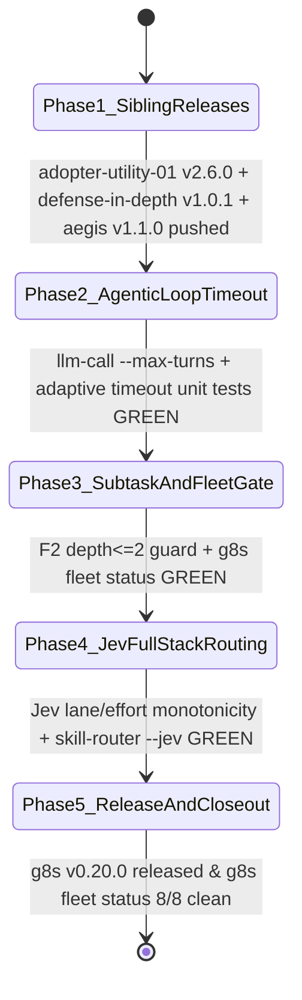

# Plan: `v0.20.0` — Bounded Agentic Loop, `F1 -> F2` Subtask Containment, Fleet Closeout Gate, Full-Stack Jev Routing & Sibling Releases

**Session type**: T2 (execution)
**Phase / Milestone**: `v0.20.0` (`DELTA-32`)

## 1. Objective

Fulfill the operator-approved `/goal` roadmap (`ck:plan` $\to$ `ck:cook`) covering all 5 validated improvements from our epistemic audit:
1. **Phase 1 — Sibling Repository Releases**: Cut and push new releases for `adopter-utility-01` (`v2.6.0`), `defense-in-depth` (`v1.0.1`), and `aegis` (`v1.1.0`).
2. **Phase 2 — Upgrade F1 `9router` from One-Shot to Bounded Agentic Loop (`K` turns) & Adaptive Effort Timeout**:
   - Add `--max-turns <K>` (default `1`, max `5`) and `--verify-cmd "<cmd>"` to `g8s llm-call` (`cmd/g8s/llm_call.go`) so `9router` workers can apply fenced file blocks, run a mechanical verification command inside `scopeRoot`, and self-repair across up to $K$ turns when verification fails.
   - Add adaptive default timeout scaling by effort level in `cmd/g8s/submit.go` (`low`/`minimal`: `45s`, `medium`: `90s`, `high`/`xhigh`/`max`: `240s`) when `--timeout` is not explicitly set on `submit`.
3. **Phase 3 — Controlled `F1 -> F2` Subtask Containment (`depth <= 2`) & Cross-Repo `g8s fleet status` Closeout Gate**:
   - Enforce `F1 -> F2` subtask containment in `cmd/g8s/submit.go` when `--parent-task-id` is passed (reject `F2 -> F3` depth `> 2` per ADR-0032, and validate child directory scope against parent task).
   - Add `./bin/g8s fleet status [--dir <workspace>] [--json]` (`cmd/g8s/fleet.go`) to audit all repositories in the workspace for dirty files, unpushed commits, orphan worktrees, stale branches, and release readiness.
4. **Phase 4 — Extend `Jev` (`TypeSafe SystemOne`) into Gate-Lane (`0/D/R/F/S`), Effort (`low..xhigh`), and Skill Routing (`skill-router.py --jev`)**:
   - Extend `jevAssist` (`internal/routing/jev_assist.go` & `internal/routing/router.go`) with `"lane"` and `"effort"` questions while enforcing **Safety Monotonicity** (Jev can upgrade lane/effort on semantic risk, never downgrade P0 trust-boundary requirements).
   - Upgrade `~/.agents/skills/_shared/scripts/skill-router.py` (`dotagents`) with `--jev` / `G8S_SKILL_ROUTER_MODE=jev_assisted` support and automatic zero-crash deterministic fallback.
5. **Phase 5 — Release `g8s v0.20.0`, Sync Offer Bundle & Skills, and Final Fleet Verification**:
   - Register `DELTA-32` across `spec/openspec/`, `manifest.json`, `.g8s/feature-map.yml`, `AGENTS.md`, `docs/AGENTS_FULL.md`, `CHANGELOG.md`; cut and push `g8s v0.20.0`; sync `dotagents` and `adopter-knowledge-01`; verify `g8s fleet status --json` across all 8 repositories.

---

## 2. Phase Overview & Layer Ownership Matrix (`DEBT-34` Compliant)

| Phase | File | Target Repo(s) | Layer (`DEBT-34`) | Status |
| :--- | :--- | :--- | :--- | :--- |
| **Phase 01** | [`phase-01-sibling-releases.md`](phase-01-sibling-releases.md) | `adopter-utility-01`, `defense-in-depth`, `aegis` | External Sibling Repos | `in_progress` |
| **Phase 02** | [`phase-02-bounded-agentic-loop-timeout.md`](phase-02-bounded-agentic-loop-timeout.md) | `g8s` (`cmd/g8s/llm_call.go`, `cmd/g8s/submit.go`) | Layer `C` (`S=0 W=0 C=1`) | `pending` |
| **Phase 03** | [`phase-03-f1-f2-subtask-and-fleet-gate.md`](phase-03-f1-f2-subtask-and-fleet-gate.md) | `g8s` (`cmd/g8s/submit.go`, `cmd/g8s/fleet.go`, `cmd/g8s/main.go`) | Layer `C` (`S=0 W=0 C=1`) | `pending` |
| **Phase 04** | [`phase-04-jev-lane-effort-skill-routing.md`](phase-04-jev-lane-effort-skill-routing.md) | `g8s` (`internal/routing/**`), `dotagents` (`skill-router.py`) | Layer `C` (`S=0 W=0 C=1`) | `pending` |
| **Phase 05** | [`phase-05-release-v0200-and-closeout.md`](phase-05-release-v0200-and-closeout.md) | `g8s`, `dotagents`, `adopter-knowledge-01` | Layer `C` + Release `v0.20.0` | `pending` |

---

## 3. FSM & Red-Test Verification Contract (`wiki-adlc` / `prove`)

## 4. Definition of Done (DoD)
- [x] **DoD-1**: `adopter-utility-01` `v2.6.0`, `defense-in-depth` `v1.0.1`, and `aegis` `v1.1.0` tagged and pushed to `origin`.
- [x] **DoD-2**: `g8s llm-call --max-turns <K> --verify-cmd "<cmd>"` self-repairs broken code in a multi-turn test and halts on pass or `K` turns; `g8s submit` scales default timeout by effort class (`45s` / `90s` / `240s`).
- [x] **DoD-3**: `g8s submit --parent-task-id` enforces `depth <= 2` (`F1 -> F2` allowed, `F2 -> F3` rejected) and child scope containment; `./bin/g8s fleet status --json` audits all 8 repositories accurately.
- [x] **DoD-4**: `jevAssist` supports `lane` and `effort` suggestions with strict safety monotonicity (never downgrading deterministic trust-boundary lane/effort); `skill-router.py --jev` supports live Jev ranking + deterministic fallback.
- [x] **DoD-5**: `g8s v0.20.0` (`DELTA-32`) released and pushed to `origin/main`, installed to `~/.local/bin/g8s`, and `g8s fleet status --json` confirms 8/8 repositories clean and pushed.
