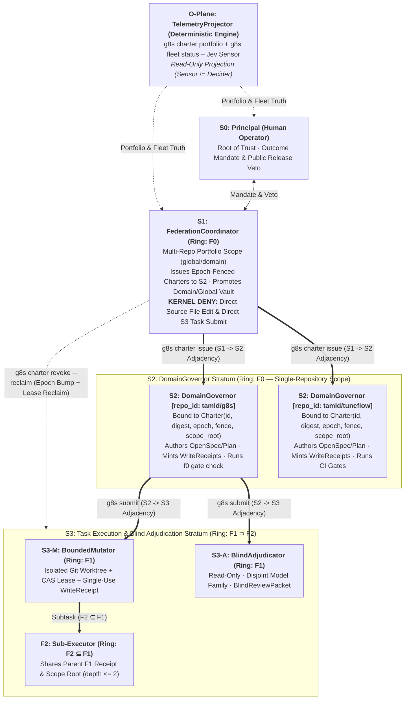
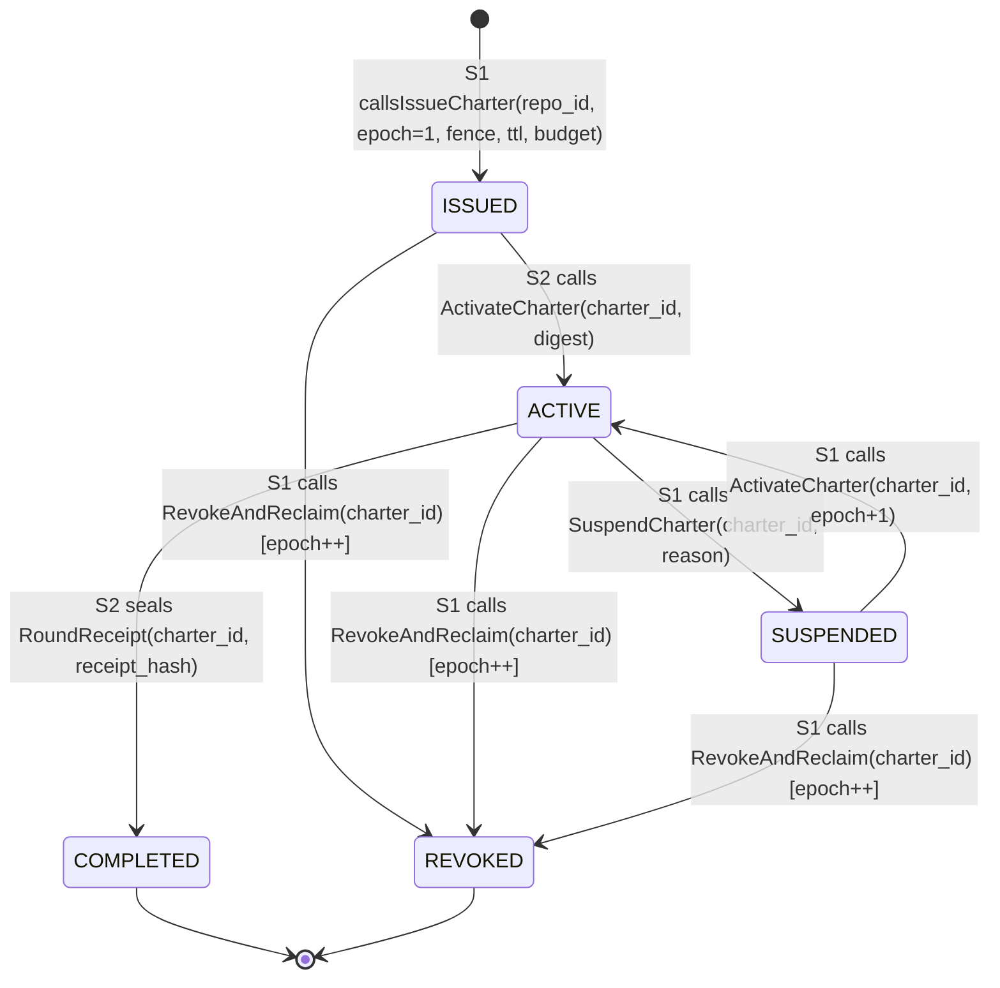

# Plan: Orthogonal Stratum Federation (`S0..S3` + `O-Plane` over `F0..F2`), Zero-Guess Manifest & Remote Decontamination (`DELTA-33` / `ADR-0035`)

- **Date**: 2026-10-25
- **Session type**: T2 (execution)
- **Status**: Completed
- **OpenSpec Delta**: `spec/openspec/33-stratum-federation-and-charter-spec.md` (`DELTA-33`)
- **ADR**: `docs/decisions/0035-orthogonal-stratum-federation.md` (`ADR-0035`)

---

## 1. Socratic Inversion & Antithesis Ledger (`wiki-socratic` WS-1..WS-4)

| # | Thesis (Initial Assumption) | Antithesis (What Makes This Fail in Production?) | Empirical Evidence (`WS-2` / `WS-3: validated`) | Repair Path (`WS-4` Synthesis) |
| :- | :--- | :--- | :--- | :--- |
| **A1** | "Delete all old docs (`ORCA_AUDIT.md`, `RELEASE_READINESS.md`, `.claude/`, `docs/goals/`, `plans/*`) in one sweep." | Deleting `ORCA_AUDIT.md` or `RELEASE_READINESS.md` breaks inbound links in `docs/CONTRIBUTING_TO_G8S.md`, `docs/INTEGRATION_PROMPT_TEMPLATE.md`, `spec/openspec/10-two-class-providers-spec.md`, causing Gate G3 (`ci_link_integrity.sh`) to fail; removing `.claude/` without updating `tools/pre_push.sh` breaks `brief_lint.sh`. | `./bin/g8s search -F "ORCA_AUDIT" .` and `./bin/g8s search -F ".claude" .` confirmed inbound references in `CONTRIBUTING_TO_G8S.md:L85-86` and `tools/pre_push.sh:L121,231`. | Purge true local agent runtimes (`.opencode/`, `.jules/`, `.claude/`, `docs/superpowers/`, `docs/goals/`, `reference/python/scripts/scratch/`, `docs/CHANGELOG.md`, `docs/history/T020-*`, `docs/designs/260924-*`, and `plans/` prior to `v0.19`), update `tools/pre_push.sh` + `.gitignore`, modernize `docs/RELEASE_READINESS.md` & `docs/REFACTORING_PLAN.md` in place, and add an anti-reintroduction check in `tools/ci_doc_contract_check.sh`. |
| **A2** | "Port `BOARD -> CEO -> TERRA -> FLASH` directly into `g8s` prompts." | Corporate/anthropomorphic titles (`CEO`, `Deputy`, `Secretary`) trigger LLM role-play priors instead of mechanical verification; model-brand titles (`TERRA`, `FLASH`) cause model-identity confusion when running on non-OpenAI/non-Gemini backends (`9router` Qwen/Claude/DeepSeek); overloading `F0` (`F0-parent` vs `F0-child`) causes recursive index collapse. | Observed in `claude-org/src/claude_org/roles.py` and `HANDOFF.md:L75-81`. | Establish **Two Orthogonal Axes**: (1) **Containment Ring (`F0 / F1 / F2`)** for OS/worktree sandboxing (`ADR-0032`), and (2) **Control Stratum (`S0 Principal` -> `S1 FederationCoordinator` + `O-Plane TelemetryProjector` -> `S2 DomainGovernor` -> `S3-M BoundedMutator` / `S3-A BlindAdjudicator`)** for authority scope. |
| **A3** | "Require an `S1` Charter for every `g8s submit` or `g8s receipt issue`." | Mandatory `S1` charter issuance would break all standalone single-repository CLI workflows, existing unit/integration tests, and CI dogfooding where an operator invokes `g8s` directly inside one repo (`S0 -> S2`). | 380+ existing tests in `internal/` and `cmd/g8s/` invoke `submit` and `receipt issue` without `G8S_STRATUM`. | Default unset `G8S_STRATUM` to `S2` (`DomainGovernor` standalone mode). When `G8S_STRATUM=S1` is active, enforce the **S1 Mutation & Adjacency Firewall**; when `--charter-id` / `G8S_CHARTER_ID` is supplied, enforce cryptographic `CharterDigest`, `RepoID`, `Epoch`, and `Fence` validation against SQLite WAL. |
| **A4** | "Enforce `S1 / S2 / S3` boundaries via `G8S_STRATUM` environment variable alone." | A compromised or hallucinating `F1` (`S3-M`) child process could run `export G8S_STRATUM=S2` in its subshell to mint a new `WriteReceipt` or issue a charter. | `internal/fsops/fsops.go` checks `G8S_TIER=F1` and `G8S_RECEIPT_ID`. | Bind federated authority to **SQLite WAL `charters` records (`internal/charter`)** with canonical SHA-256 `CharterDigest`, monotonic `Epoch`, and `Fence` token, AND block any process carrying `G8S_TIER=F1`/`F2` or `G8S_STRATUM=S3` from issuing charters or write receipts. |
| **A5** | "Keep `fast-agent` and `nvidia/qwen/qwen3-next-80b-a3b-instruct` as default recommendations." | Upstream `qwen3-next-80b-a3b-instruct` returns `HTTP 410 Gone (EOL)`, and `fast-agent` on `9router` injects `reasoning_effort: xhigh` into a vLLM backend that only accepts `low|medium|high` (`HTTP 400`). | Live F1 dogfooding runs `ffbe49e4` and `01a16edd` captured exact HTTP 400/410 envelopes. | Update `.g8s/agent-models.yml`, `manifest.json`, and OS-level strategic memory (`skills/g8s-supervisor/SKILL.md`) with live-verified `9router` combos (`deep-coding`, `reasoning-high`, `docs-retriever`, `cl/anthropic/claude-sonnet-4.6`, `cl/anthropic/claude-haiku-4.5`, `cl/openai/gpt-4.1-mini`, `cl/google/gemini-2.5-flash`). |

---

## 2. System Design: Orthogonal Stratum Federation (`S0..S3` + `O-Plane` $\times$ `F0..F2`)

### 2.1. Two-Axis Architecture Diagram

### 2.2. Charter Lifecycle & Epoch-Fenced State Machine (`internal/charter`)

---

## 3. Feature Map & Zero-Guess `manifest.json` Specification

1. **`.g8s/feature-map.yml`**:
   - Add feature `charter_governance` (`name: "Orthogonal Stratum Federation & Epoch-Fenced Charter Engine"`, `status: "Done"`, `since_version: "v0.20.0"`, `package_paths: ["internal/charter"]`, `cli_commands: ["charter"]`, `mcp_tools: ["g8s_charter_issue", "g8s_charter_verify", "g8s_portfolio_status"]`, `spec_deltas: ["spec/openspec/33-stratum-federation-and-charter-spec.md"]`, `adrs: ["docs/decisions/0035-orthogonal-stratum-federation.md"]`, `depends_on: ["receipt_engine", "fleet_hygiene"]`, `direct_consumers: ["cli_surface", "mcp_stdio_server"]`).
   - Update `receipt_engine.direct_consumers`, `fleet_hygiene.direct_consumers`, `cli_surface.depends_on`, and `mcp_stdio_server.depends_on` to preserve 100% bidirectional DAG edge symmetry (`#665`).
2. **`manifest.json`**:
   - Add top-level `"architecture_taxonomy"` containing `"containment_rings"` (`F0`, `F1`, `F2`) and `"control_strata"` (`S0`, `S1`, `S2`, `S3-M`, `S3-A`, `O-Plane`) with explicit `allowed_actions`, `denied_actions`, `env_bindings`, and `adjacency_targets` so any AI agent reading `manifest.json` has zero ambiguity.
   - Add `"verified_model_routing"` under `provider_routing` documenting the live-verified `9router` combos (`deep-coding`, `reasoning-high`, `docs-retriever`, `cl/anthropic/claude-sonnet-4.6`, `cl/anthropic/claude-haiku-4.5`, `cl/openai/gpt-4.1-mini`, `cl/google/gemini-2.5-flash`).
   - Register `DELTA-33` (`spec/openspec/33-stratum-federation-and-charter-spec.md`), `ADR-0035` (`docs/decisions/0035-orthogonal-stratum-federation.md`), CLI subcommand `"charter"`, and the 3 new MCP tools (`19` total MCP tools).

---

## 4. Red-Test Proof Matrix

| Test Name | Package | Scenario Verified |
| :--- | :--- | :--- |
| `TestCharterLifecycleAndCanonicalDigest` | `internal/charter` | Issues an `S1 -> S2` charter, verifies canonical SHA-256 `CharterDigest`, transitions `ISSUED -> ACTIVE -> SUSPENDED -> REVOKED`, and confirms monotonic `Epoch` bump on `RevokeAndReclaim`. |
| `TestStratumAdjacencyAndMutationFirewall` | `internal/charter` | Verifies `ValidateAdjacency` allows `S0->S1`, `S1->S2`, `S2->S3` and rejects `S1->S3` (`E_STRATUM_ADJACENCY_VIOLATION`) or `S3->S2`; verifies `VerifyMutationAllowed` blocks `S1` from mutating repo source files (`E_S1_DIRECT_MUTATION_FORBIDDEN`). |
| `TestCharterFenceRejectsStaleEpoch` | `internal/charter` | Verifies that once `S1` calls `RevokeAndReclaim` (bumping `epoch` from 1 to 2), an `S2` presenting `epoch=1` or stale `fence` is deterministically rejected (`E_CHARTER_FENCE_STALE`). |
| `TestFSOPSEnforcesS1MutationFirewall` | `internal/fsops` | Verifies `VerifyWriteScope` rejects file edits when `G8S_STRATUM=S1` even if a wildcard path is passed. |

---

## 5. Phased Execution Waves (`DEBT-34` Layer-Disjoint Discipline)

- **Wave 1 — Repository Decontamination, Anti-Reintroduction Gate & Remote Branch Pruning**:
  - Untrack and remove `.opencode/`, `.jules/`, `.claude/`, `docs/superpowers/`, `docs/goals/`, `reference/python/scripts/scratch/`, `docs/CHANGELOG.md`, `docs/history/T020-*`, `docs/designs/260924-*`, and historical `plans/` prior to `261020-*`.
  - Update `.gitignore`, `tools/pre_push.sh`, `tools/ai_lint.sh`, `tools/ci_doc_contract_check.sh`, `docs/RELEASE_READINESS.md`, and `docs/REFACTORING_PLAN.md`.
  - Prune 22 stale branches on `origin` and 176 ephemeral branches on `ct122`.
- **Wave 2A (`internal/` Layer Commit) — `internal/charter`, `internal/fsops`, `internal/mcp`**:
  - Implement `internal/charter/charter.go` and `internal/charter/charter_test.go`.
  - Wire `S1` mutation firewall in `internal/fsops/fsops.go` + unit test in `internal/fsops/fsops_test.go`.
  - Expose `g8s_charter_issue`, `g8s_charter_verify`, `g8s_portfolio_status` in `internal/mcp/server.go` + update `internal/mcp/server_test.go`.
- **Wave 2B (`cmd/` + Governance/Docs Layer Commit) — `cmd/g8s/charter.go`, `ADR-0035`, `DELTA-33`, Feature Map & `manifest.json`**:
  - Implement `cmd/g8s/charter.go` (`g8s charter issue|activate|verify|revoke|list|portfolio`) and wire in `cmd/g8s/main.go`, `cmd/g8s/submit.go`, `cmd/g8s/receipt.go`.
  - Synchronize `.g8s/feature-map.yml`, `.g8s/agent-models.yml`, `manifest.json`, `docs/SRS.md`, `docs/AGENTS_FULL.md`, `docs/user-guide/cli-reference.md`, `docs/user-guide/mcp-tools.md`, `docs/claims.yml`, `AGENTS.md`, and `README.md` (`tools/ci_structure_sync.sh --render`).
