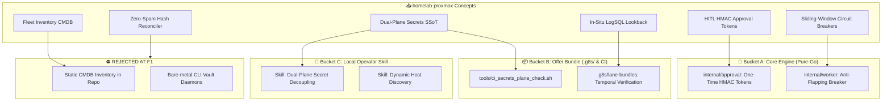

# Round 1 Concept Harvesting & Multi-Agent Debate: `homelab-proxmox` -> `g8s`

> **Session type**: T1 (strategy)

> **Handoff Type**: F1 Middle Manager Synthesis & Advisory Report  
> **Target Deliverable**: `plans/handoffs/r1-ingest-homelab-proxmox.md`  
> **Source Sibling Repository**: `/Users/tamld/Documents/github/homelab-proxmox`  
> **Evaluation Base**: `/Users/tamld/Documents/github/g8s`  
> **WriteReceipt ID**: `970858a9-d1ed-4d57-bee9-6d4a4583a4ba`  
> **Execution Timestamp**: 2026-10-21T13:43:00Z  

---

## 1. Executive Summary & Core Thesis for `homelab-proxmox` -> `g8s`

### 1.1 Context & Strategic Framing
`homelab-proxmox` is an infrastructure and autonomous SRE repository managing an 18-LXC container fleet running on an Intel N100 hypervisor with Proxmox VE 9.x. It combines zero-trust identity (Pocket ID, Authelia), centralized observability (VictoriaLogs, VictoriaMetrics, Uptime Kuma), an AI model gateway (`9router`), and an autonomous in-situ SRE Butler daemon named "Xoài" (`CT121`). It adopted `g8s` during Wave 3 (issue `#442`, commit `982f0a1`) and has already contributed to `g8s` Offer Bundle evolution (Returns #4, #5, #15).

`g8s` is an empowering, Pure-Go, Zero-CGO, single-binary **Agent Execution & LLM Call Platform** (`CLI + MCP + HTTP`). As established by F0:
> **The Core Axiom**: `g8s` builds an empowering foundation for LLM calls and multi-agent execution — **NOT a bureaucratic shackle ("không phải gọng kiềm siết chết khả năng của Agent")**. Security and containment live strictly at the perimeter (`WriteReceipt`, worktree isolation, deterministic verifiers), while inside that perimeter agents have maximum cognitive and tool autonomy.

### 1.2 Core Thesis
The primary value of `homelab-proxmox` to `g8s` does **NOT** lie in its static infrastructure topology, container configurations, or Python daemon code. Incorporating infrastructure manifests or CMDB abstractions into `g8s` would bloat the binary and shackle agents to stale snapshots.

Instead, `homelab-proxmox` reveals **two critical autonomous execution patterns** that directly address gaps in `g8s`'s perimeter defense and agent resilience:
1. **Cryptographic Human-in-the-Loop (HITL) Capability Elevation (`internal/approval`)**: In high-blast-radius operations (P0 trust boundary modifications, irreversible state destruction, dangerous delivery gates), agents currently have no standardized, non-interactive, time-bounded capability grant. Adopting Butler's time-bounded HMAC-SHA256 one-time approval token mechanism (`hitl_gateway.py`) enables agents to propose high-risk actions, receive a signed one-time capability ticket from the operator, and redeem it atomically — empowering agent initiative without compromising operator authority.
2. **Anti-Flapping Sliding-Window Circuit Breakers (`internal/worker`)**: Butler's `check_circuit_breaker` (`event_bus.py:147-162`) prevents runaway recovery thrashing. Implementing this in `g8s`'s worker queue protects operators from unbounded LLM token consumption and cascading execution loops when workers repeatedly fail on unresolvable tasks.

---

## 2. F2 Team Roster & Debate Log (Evidence of `F1 -> n F2` Orchestration)

To rigorously vet candidates, the F1 Middle Manager orchestrated four heterogeneous F2 workers across platform-native subagents and heterogeneous `9router` model calls.

### 2.1 F2 Team Roster

| Worker ID / Trace ID | Platform / Model | Persona / Role | Scope & Context Files Inspected | Latency / Tokens |
|:---|:---|:---|:---|:---|
| **Subagent `98c4e28c`** | Native Subagent (`gemini-3.8-flash-high`) | **F2-Researcher**: Deep-dive architecture and operational mechanics | `docs/architecture/7-layer-homelab-ssot.md`, `ADR-008`, `butler/src/*.py`, `homelab-sbom.json`, `.g8s/*.yml` | 137s multi-turn deep traversal |
| **`01a15eb0-d7d4...`** | `9router` (`cx/gpt-6-luna`, low effort) | **F2-Harvester**: Value extraction & developer UX patterns | `README.md`, `7-layer-homelab-ssot.md`, `ADR-008`, `butler/README.md` | 4,232 ms<br/>(9,127 in / 359 out) |
| **`01a15eb1-0212...`** | `9router` (`reasoning-high` -> `nemotron-3-ultra-550b`) | **F2-Skeptic**: Devil's Advocate & constitutional falsifier | `README.md`, `ADR-008-Dual-Plane-Secrets-SSoT.md` | 37,547 ms<br/>(8,048 in / 1,517 out) |
| **`01a15eb1-bdcd...`** | `9router` (`cx/gpt-5.6-terra`, med effort) | **F2-Architect**: Pure-Go Zero-CGO systems design | `butler/src/hitl_gateway.py`, `ADR-008-Dual-Plane-Secrets-SSoT.md` | 50,847 ms<br/>(2,270 in / 4,975 out) |

---

### 2.2 The Multi-Agent Debate & F1 Adjudication Log

#### Debate Point 1: Fleet Inventory SSoT (Static Topology Tables)
- **F2-Harvester**: Proposed standardizing machine-readable inventory schemas in `g8s` so agents can read node/container IDs, IP addresses, and service ports to automatically route tasks and generate policies (`README.md §6`, `7-layer-homelab-ssot.md §6`).
- **F2-Skeptic (Clash)**: Strongly attacked the proposal: *"Violation of Law 1 and Law 2. g8s is an execution engine, not a CMDB. Storing static topology in repo tables creates a massive drift surface and shackles the LLM to stale snapshots. An agent must discover live topology at runtime via provider APIs (`pct list`, `pvesh`, `docker ps`), not read cached CSV/YAML tables."*
- **F1 Adjudication**: **UPHELD SKEPTIC — REJECTED AT F1**. A static CMDB inside `g8s` violates Mechanism-over-Prose. Target discovery must be dynamic and tool-driven.

#### Debate Point 2: Human-in-the-Loop (HITL) Time-Bounded HMAC Approval Tokens
- **F2-Harvester**: Highlighted Butler's interactive HMAC-SHA256 cards (`hitl_gateway.py:14-41`) as an effective pattern for allowing agents to request human approval before executing destructive actions.
- **F2-Skeptic (Analysis)**: Agreed that this is a **Bucket A** core engine primitive. Standardizing time-bounded cryptographic tokens empowers agent autonomy: the LLM initiates the proposal, generates an idempotency key, waits for an out-of-band human sign-off, and redeems the token without holding stateful human-in-the-loop locks. Skeptic cautioned that replay protection requires atomic single-use nonce tracking.
- **F2-Architect (Refinement)**: Identified a security weakness in Butler's implementation: Butler truncated HMAC to 16 hex chars (64-bit entropy) and relied on an external Telegram bot. Architect drafted a Pure-Go specification using full 256-bit SHA-256 HMAC (`v1.<claims>.<mac>`), atomic nonce consumption via file locking (`O_EXCL`), and a zero-dependency CLI/MCP contract.
- **F1 Adjudication**: **CONSENSUS REACHED — ADOPTED INTO BUCKET A (Blueprint 1)**.

#### Debate Point 3: Dual-Plane Secrets Architecture
- **F2-Harvester**: Proposed adopting `ADR-008`'s Dual-Plane secrets pattern (segregating 0600 file-based automation credentials from human vaults) directly into the `g8s` core engine to prevent circular dependencies.
- **F2-Skeptic (Clash)**: Objected: *"Violation of Law 1 & 2. g8s reads secrets from `os.Getenv` or files. Managing secrets storage architecture is an operator policy concern, not a platform concern. If the engine mandates 'dual-plane' files, it shackles operators who use HashiCorp Vault, 1Password CLI, or SOPS. The engine must remain strictly agnostic (`secretSource: env | file | exec`)."*
- **F2-Researcher**: Noted that `ADR-008`'s core security lesson—avoiding circular dependencies on automated CLI daemons—is vital for production stability and should be taught to sibling repositories via the Offer Bundle.
- **F1 Adjudication**: **SPLIT ROUTING**.
  - **Core Engine (g8s)**: Rejects hardcoding storage models. Maintains pure injection interfaces.
  - **Offer Bundle (Bucket B)**: Introduces an optional DLP CI check script (`tools/ci_secrets_plane_check.sh`) ensuring automated tasks do not rely on interactive vault daemons.
  - **Operator Skill (Bucket C)**: Documents the Dual-Plane decoupling pattern in `~/.agents/skills/` for infrastructure automation.

#### Debate Point 4: Autonomous Anti-Flapping Circuit Breakers
- **F2-Researcher**: Identified Butler's `check_circuit_breaker` (`event_bus.py:147-162`), which records restarts in a sliding 600s window and halts execution after 3 failures.
- **F2-Architect**: Pointed out that `g8s worker` and `g8s watch --failed` currently lack an in-process sliding-window rate damper. A failing task repeatedly retried burns LLM tokens endlessly.
- **F2-Skeptic**: Validated that sliding-window rate dampers belong in Pure-Go within `internal/worker` and `internal/queue`, requiring zero CGO and zero external services.
- **F1 Adjudication**: **CONSENSUS REACHED — ADOPTED INTO BUCKET A (Blueprint 2)**.

---

## 3. Round-1 Candidate Classification Matrix (3-Bucket Routing)



| Candidate Concept | Source Citation in `homelab-proxmox` | Target Destination in `g8s` | Technical Rationale & Agent Empowerment Impact |
|:---|:---|:---|:---|
| **1. Cryptographic HITL Approval Tokens** | `butler/src/hitl_gateway.py:14-41`, `event_bus.py:524-550` | **Bucket A** (`internal/approval/`, `cmd/g8s/approval*.go`, `internal/mcp/`) | Provides a standard, non-blocking capability elevation protocol. Empowers agents to propose high-risk actions and receive signed, time-bounded permission without manual supervisor code injection. |
| **2. Sliding-Window Task Circuit Breaker** | `butler/src/event_bus.py:147-162, 280-288` | **Bucket A** (`internal/worker/circuit.go`, `internal/queue/`) | Prevents cascading LLM token burn when workers encounter unresolvable build or test failures. In-memory sliding window trips into a review-required state. |
| **3. Dual-Plane Secret Boundary Gate** | `docs/architecture/ADR-008-Dual-Plane-Secrets-SSoT.md:9-21` | **Bucket B** (`offer/profiles/infra.md`, `offer/tools/ci_secrets_plane_check.sh`) | Repo-agnostic CI gate verifying that automated scripts don't depend on interactive vault daemons, preventing circular failure modes across sibling repos. |
| **4. Temporal Forensic Lookback Verifier** | `butler/src/threat_defense_engine.py:158-166`, `event_bus.py:424-446` | **Bucket B** (`.g8s/lane-bundles.yml`, `.g8s/verifier-classes.yml`) | Augments Lane `R`/`F` verifiers with bounded time-window log scanning (`task.StartedAt` to `task.FinishedAt`) to catch silent runtime panics and race warnings. |
| **5. Decoupled Infra Secret Management** | `docs/architecture/SRS-Dual-Plane-Secrets-Management.md:1-38` | **Bucket C** (`~/.agents/skills/g8s-supervisor/`) | Procedural playbook teaching agents to separate non-interactive daemon keys from personal credential vaults during infrastructure task automation. |
| **6. Dynamic Hypervisor Discovery Pattern** | `proxmox/scripts/*.sh`, `butler/src/action_proxy.py:25-83` | **Bucket C** (`~/.agents/skills/g8s-supervisor/`) | Teaches supervisor agents to probe live container status via REST API/CLI rather than relying on stale documentation tables. |

---

## 4. Explicitly Rejected Ideas (`REJECTED AT F1`)

The F1 Middle Manager and F2-Skeptic evaluated and **explicitly rejected** three concepts from entering `g8s`:

### Rejection 1: Static Fleet Inventory & CMDB Tables
- **Source**: `homelab-proxmox/README.md §6` ("Comprehensive 18-Container Fleet Inventory"), `docs/architecture/7-layer-homelab-ssot.md §6`.
- **Proposal**: Introduce a declarative YAML/JSON inventory format in `.g8s/fleet.yml` to track node IPs, containers, and ports.
- **Hard Falsification Grounds**:
  1. *Anti-Pattern for Agent Platform*: `g8s` is an execution harness and LLM calling platform. It is not an asset management database (CMDB).
  2. *Drift Surface & Cognitive Poisoning*: Hardcoding IPs and container IDs into repo files creates instant documentation drift. If an agent trusts a markdown table instead of querying the hypervisor API, it acts on stale assumptions (e.g., attempting to restart a container that was relocated or decommissioned).
  3. *Empowerment Violation*: Shackles the agent to static documentation rather than encouraging dynamic environmental discovery via native tools (`pct list`, `pvesh`).

### Rejection 2: Automated CLI Vault Injection Daemons (`bw serve` / Bitwarden CLI)
- **Source**: Evaluated and rejected in `homelab-proxmox`'s own `docs/architecture/ADR-008-Dual-Plane-Secrets-SSoT.md`.
- **Proposal**: Add a built-in background vault unlocker daemon in `g8s` to dynamically retrieve API keys from password managers over local HTTP.
- **Hard Falsification Grounds**:
  1. *Fatal Circular Dependency*: If the network or vault crashes, all automated monitoring, alerting, and worker execution halt simultaneously.
  2. *Secret Zero Paradox*: Requires storing master unlock passphrases unencrypted in memory or disk to unlock the daemon unattended at boot.
  3. *Runtime Pollution*: Requires bundling Node.js/npm or external binaries into what must remain a self-contained, Zero-CGO pure Go platform.

### Rejection 3: Cron-Driven GitOps Drift Commits ("Zero-Spam Reconciler")
- **Source**: `homelab-proxmox/README.md §3` ("GitOps Zero-Spam State Reconciliation Workflow").
- **Proposal**: Embed an internal scheduled loop inside `cmd/g8s` to periodically probe target hosts and automatically commit state changes to git.
- **Hard Falsification Grounds**:
  1. *Scope Creep*: `g8s` is not an Ansible or Flux/ArgoCD clone. Embedding recurring cron daemons for infrastructure state synchronization violates the single-binary agent harness boundary.
  2. *Git Pollution Risk*: Automated unattended background commits risk race conditions with human git operations and active worker worktrees. Infrastructure reconciliation belongs in external GitOps controllers, not inside the agent CLI.

---

## 5. Top 1–2 Implementation Blueprints for Round 2 Review

### Blueprint 1: Cryptographic One-Time HITL Approval Tokens (`internal/approval`)

#### Problem Statement
When an agent or worker needs to perform a high-blast-radius mutation (e.g., pruning unharvested worktrees, modifying `.g8s/trust-boundaries.yml`, or executing actions in security lane `S`), there is currently no mechanism for the agent to request out-of-band authorization and receive a machine-verifiable, single-use, time-bounded proof of approval.

#### Architecture & Package Placement
```text
internal/approval/
├── claims.go       # Token payload definition, Base64URL encoding, HMAC-SHA256 signing
├── store.go        # Atomic single-use nonce consumption via modernc.org/sqlite or filesystem
├── service.go      # Request, Mint, and Redeem orchestration
└── service_test.go # Deterministic unit tests with injectable Clock
cmd/g8s/
└── approval.go     # CLI commands: request-approval, approve, redeem
internal/mcp/
└── tools_approval.go # MCP tool: request_approval
```

#### Core Structs & Cryptographic Contract
```go
package approval

import (
	"crypto/hmac"
	"crypto/rand"
	"crypto/sha256"
	"encoding/base64"
	"encoding/json"
	"errors"
	"fmt"
	"io"
	"time"
)

type Clock interface {
	Now() time.Time
}

type RealClock struct{}
func (RealClock) Now() time.Time { return time.Now().UTC() }

// Claims defines the immutable token payload.
type Claims struct {
	Version   string `json:"v"`   // "v1"
	RequestID string `json:"rid"` // UUID v7 request tracking ID
	Nonce     string `json:"n"`   // 16-byte cryptographically random nonce
	Action    string `json:"a"`   // Bounded action identifier (e.g., "prune_worktree")
	Target    string `json:"t"`   // Path or resource target (e.g., "wt-97fdb5dd")
	IssuedAt  int64  `json:"iat"` // Unix timestamp
	ExpiresAt int64  `json:"exp"` // Unix timestamp (typically now + 300s)
}

// Mint issues a full 256-bit HMAC-SHA256 token in format: v1.<payload_b64>.<signature_b64>
func Mint(key []byte, clock Clock, randSource io.Reader, reqID, action, target string, ttl time.Duration) (string, error) {
	nonceBytes := make([]byte, 16)
	if _, err := io.ReadFull(randSource, nonceBytes); err != nil {
		return "", fmt.Errorf("entropy failure: %w", err)
	}

	now := clock.Now().UTC()
	claims := Claims{
		Version:   "v1",
		RequestID: reqID,
		Nonce:     base64.RawURLEncoding.EncodeToString(nonceBytes),
		Action:    action,
		Target:    target,
		IssuedAt:  now.Unix(),
		ExpiresAt: now.Add(ttl).Unix(),
	}

	rawClaims, err := json.Marshal(claims)
	if err != nil {
		return "", err
	}

	payload := base64.RawURLEncoding.EncodeToString(rawClaims)
	mac := hmac.New(sha256.New, key)
	mac.Write([]byte("g8s-approval/v1."))
	mac.Write([]byte(payload))
	sig := base64.RawURLEncoding.EncodeToString(mac.Sum(nil))

	return fmt.Sprintf("v1.%s.%s", payload, sig), nil
}
```

#### CLI & MCP Interface
1. **Agent Requests Approval**:
   ```bash
   g8s request-approval \
     --action "prune_worktree" \
     --target "wt-97fdb5dd" \
     --reason "Free disk space after Wave A merge" \
     --idempotency-key "task-efe5e53e-cleanup" \
     --json
   ```
   *Output*:
   ```json
   {
     "status": "pending",
     "request_id": "01a15eb2-411a-7b32-8234-91283749a21b",
     "expires_at": "2026-10-21T13:48:00Z",
     "message": "Approval card dispatched. Awaiting human operator sign-off."
   }
   ```
2. **Operator Approves (via CLI or Mobile Webhook)**:
   ```bash
   g8s approve 01a15eb2-411a-7b32-8234-91283749a21b --json
   ```
   *Output*: Returns signed `v1.<payload>.<sig>` token.
3. **Agent Redeems Token in Protected Command**:
   ```bash
   g8s deliver --prune-worktree wt-97fdb5dd --approval-token "v1.eyJ2Ijoi..."
   ```
   *Verification*: `deliver` calls `approval.Redeem()`. If signature matches, clock `< exp`, and nonce has not been consumed, operation proceeds and nonce is recorded in SQLite as consumed.

#### Deterministic Verification Strategy
- **Mock Clock Injection**: Test uses `type fakeClock struct { now time.Time }` to verify exact expiration at `exp + 1s` with **zero sleep delays**.
- **Cryptographic Negative Tests**: Assert rejection for: (1) tampered payload, (2) tampered signature, (3) wrong HMAC key, (4) expired timestamp, (5) reused nonce (replay attack assertion), (6) action/target mismatch.

---

### Blueprint 2: Sliding-Window Worker Flapping Circuit Breaker (`internal/worker`)

#### Problem Statement
When autonomous worker tasks encounter recurring build errors, permission denials, or unresolvable test flakes, automated retries (`g8s watch --failed` or multi-round supervisors) can enter an infinite failure loop. This thrashes CPU resources and exhausts LLM token budgets.

#### Architecture & Placement
```text
internal/worker/
├── circuit.go      # Sliding-window failure counter & state machine (CLOSED -> OPEN -> HALF-OPEN)
├── circuit_test.go # Deterministic rate-limiting unit tests
└── worker.go       # Integrated check before task dispatch
```

#### Core Data Structures
```go
package worker

import (
	"sync"
	"time"
)

type CircuitState string
