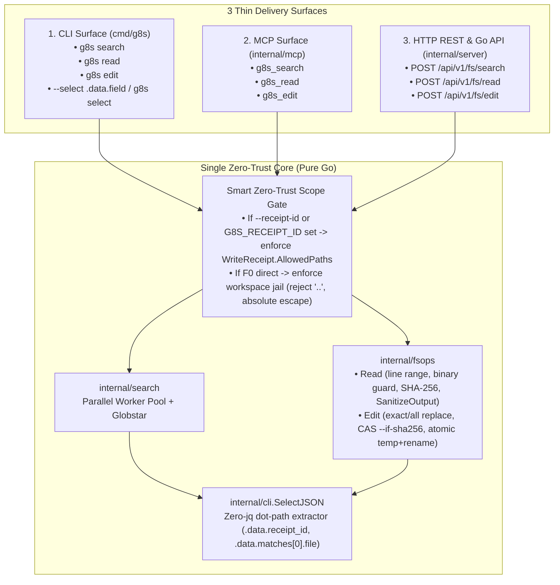

# Brainstorm Report: Native Cross-Platform Agent I/O & Task Query Primitives (`g8s`)

- **Date**: 2026-10-15
- **Session type**: T1 (strategy)
- **Status**: Agreed Design (Ready for `/ck:plan`)
- **Target Packages**: `internal/search`, `internal/fsops`, `internal/cli`, `internal/mcp`, `internal/server`, `cmd/g8s`, `tools/`

---

## 1. Problem Statement & Empirical Frequency Audit

Across macOS (BSD userland), Linux (GNU userland), and Windows, F0 Supervisors, F1 Workers, and Offer CI gates suffer from OS command fragmentation (`sed -i ''` vs `sed -i`, `head -n -5`, missing `jq`, slow `find | xargs grep` pipelines).

An empirical audit of `tools/`, `offer/`, `scripts/`, and `Makefile` using `./bin/g8s search` revealed **706 external CLI invocations** across 5 categories:

| Category | Legacy OS Tools | Repo Count | Runtime F0/F1 Frequency | OS Fragmentation Risk | Decision |
| :--- | :--- | :---: | :---: | :---: | :---: |
| **Cat 1: Discovery & Search** | `grep` (214), `rg` (39), `find` (33) | **286** | Very High | High | **Included** (Migrate remaining `tools/*.sh` to `g8s search`) |
| **Cat 2: Atomic Edit & Patch** | `sed` (96), `diff` (38), `awk` (33), `mktemp` (23), `patch` (6) | **196** | Very High | **Critical** (`sed -i ''` vs `sed -i`) | **Included** (`fsops.Edit`) |
| **Cat 3: Bounded File Read** | `cat` (109), `head` (42), `wc` (8), `tail` (4) | **163** | Very High | Medium–High | **Included** (`fsops.Read`) |
| **Cat 4: JSON / Envelope Query** | `jq` (24), `tr` (23), `sort` (7), `cut` (7) | **61** | Very High (every `--json` call) | High (missing `jq` breaks scripts) | **Included** (`cli.SelectPath` / `--select`) |
| **Cat 5: Misc OS Utils** | `tree` (19), `xargs` (11), `shasum` (6), `timeout` (4) | **40** | Low | Low–Medium | **Deferred (YAGNI)** (`sha256` embedded in Read/Edit metadata) |

---

## 2. Agreed Architecture: 1 Core Engine -> 3 Delivery Surfaces (CLI + MCP + API)

Instead of duplicating logic across shell scripts, CLI flags, MCP handlers, and HTTP endpoints, `g8s` implements a **Single Core Engine (`internal/search` + `internal/fsops` + `internal/cli`)** exposed uniformly across **3 Thin Adapters**:

### 2.1. Core Package Specifications
1. **`internal/fsops` (Cat 2 & Cat 3)**:
   - `Read(ctx, ReadOptions) (*ReadResult, error)`:
     - Supports 1-indexed line slicing (`StartLine`, `EndLine` via `--lines M:N`), binary file detection (512-byte NUL check), `MaxCaptureBytes` bound, full-file `sha256` digest calculation, and central DLP sanitization (`dispatch.SanitizeOutput`).
   - `Edit(ctx, EditOptions) (*EditResult, error)`:
     - Pre-validates path against `search.MatchesAllowedPaths` before touching disk.
     - Optional optimistic concurrency guard (`IfSHA256`): aborts with `E_CONFLICT` if file changed since `Read`.
     - Performs exact block replacement (`OldString` -> `NewString`, single match by default or `--all`), preserving original line endings (`LF`/`CRLF`) and file mode via atomic temp-file + `os.Rename` in the target directory.
2. **`internal/cli` Dot-Path Selector (Cat 4)**:
   - `SelectPath(rawJSON []byte, expr string) (string, error)`:
     - Supports `.a.b.c`, array indexing `.items[0].id`, and array projection `.items[].file` without external `jq`.
     - Wired as global `--select <expr>` flag on `g8s` JSON envelopes and standalone `g8s select <expr>` reading from `stdin`.
3. **Smart Zero-Trust Receipt Resolution**:
   - Priority: explicit `--receipt-id` (or API/MCP `receipt_id` field) -> `G8S_RECEIPT_ID` env var (automatically present in F1 worker environments) -> workspace-root traversal guard (`..`, `/`, Windows drive letters rejected) when invoked directly by F0/operator.

---

## 3. Risks & Mitigations
- **Risk 1 (CRLF vs LF corruption on Windows/macOS)**: `fsops.Edit` normalizes search comparison while preserving the file's native newline sequence when writing.
- **Risk 2 (Partial write on crash)**: `fsops.Edit` writes to a sibling `.g8s-tmp-*` file in the same directory and calls `os.Rename` (POSIX atomic) after `Sync()`.
- **Risk 3 (API surface exposure)**: `/api/v1/fs/*` routes sit behind `Server.authMiddleware` (Bearer token) and `maxRequestBodyBytes` (1 MiB) and require an active `receipt_id` for `POST /api/v1/fs/edit`.

## 4. Success Metrics
- `0` `sed -i` or `find | xargs grep` calls remaining in `tools/ai_lint.sh` and `tools/brief_lint.sh`.
- `100%` of `g8s` receipt/task ID extractions executable via `--select` without `jq` installed.
- `>= 85%` statement coverage on `internal/fsops` and `internal/cli` selector, passing `go test -race` and `golangci-lint` (`0` issues).
